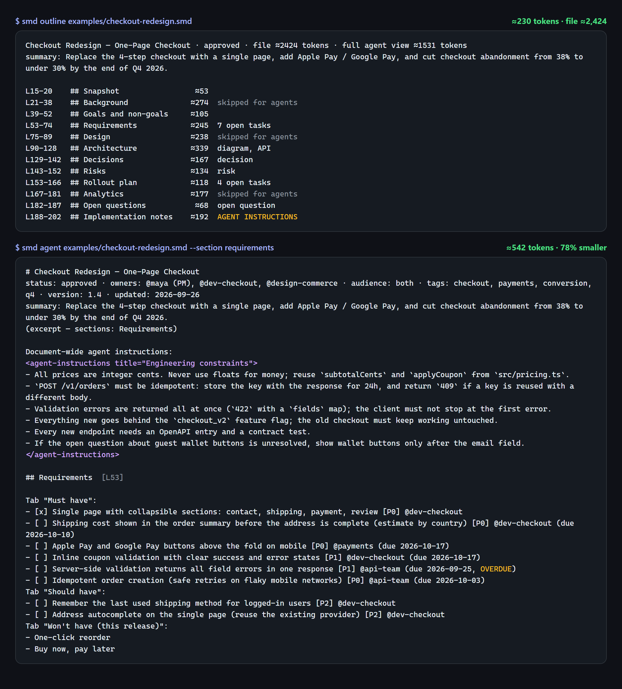

<p align="center">
  
</p>

<h1 align="center">Styled Markdown (<code>.smd</code>)</h1>

<p align="center">
  <b>One document format for developers, product managers and AI agents.</b><br>
  Markdown plus callouts, colors, diagrams, decisions, risks, APIs and KPIs, with live preview, validation and token-efficient agent views.
</p>

<p align="center">
  <a href="https://github.com/bislink360/styled-markdown/releases/latest"></a>
  
  <a href="LICENSE"></a>
</p>

<p align="center">
  <a href="#install">Install</a> ·
  <a href="docs/FEATURES.md">Feature guide</a> ·
  <a href="docs/SKILLS.md">Agent skills</a> ·
  <a href="examples/">Examples</a> ·
  <a href="docs/SPEC.md">Specification</a>
</p>

---


## Why Styled Markdown?

Markdown is the lingua franca of engineering docs, but teams keep stretching it. `**IMPORTANT:**` stands in for warnings, raw HTML for color and layout, and nobody finds a broken diagram until someone opens the file. AI agents reading those docs spend tokens on decoration and history, and can't tell a hard constraint from a side note.

`.smd` fixes this without leaving Markdown behind:

- **Every `.md` file is already a valid `.smd` file.** Rename it and add styling where it helps.
- **Meaning is explicit.** `:::warning`, `:::decision`, `:::risk`, `:::api` and `:::agent` say what content *is*, not just how it looks.
- **Everything is validated,** with rule codes and automatic fixes, in VS Code and in CI.
- **Agents read only what matters.** An *agent view* strips styling, layout and human-only sections, typically **cutting 37–85% of tokens** without losing meaning.
- **Safe and portable.** No scripts, whitelisted styles, and a one-command export to HTML or GitHub Markdown.

| | Developers | Product & project managers | AI agents |
|---|---|---|---|
| Write | API blocks, code highlights, live code embeds, diagrams, math | Decisions, risks, timelines, KPIs, task owners and due dates | A writer skill with 13 templates and a validator |
| Read | Syntax-highlighted preview, outline, folding | Status header, colored callouts, overdue tasks in red | A reader skill: outline → only the needed sections |
| Check | Problems panel + quick fixes, `smd validate` in CI | `smd tasks` across all docs, overdue first | `--json` diagnostics with machine-applicable fixes |

## At a glance

<table>
<tr>
<td width="50%"><br><sub><b>Project management:</b> KPI tiles, tasks with priority/owner/due date, decisions, risks, timelines</sub></td>
<td width="50%"><br><sub><b>Developers:</b> API endpoints, code embedded from the repo with line highlights, Mermaid diagrams</sub></td>
</tr>
<tr>
<td width="50%"><br><sub><b>Layout & theming:</b> cards, columns, tabs, diagrams, math. Light and dark follow VS Code.</sub></td>
<td width="50%"><br><sub><b>Agent view:</b> an outline with per-section token costs, then only the section needed (78% fewer tokens)</sub></td>
</tr>
</table>

## A taste of the syntax

````markdown
---
smd: 1
title: Saved Searches
summary: Let users save a search and get notified when new results match.
status: review
owners: ["@product-search"]
---

:metric[38%]{label="Abandonment" delta="-2.1pp" trend=down good=down}

:::warning Breaking change
`GET /v1/search` requires the `filters` object from 2026-11-01.
:::

- [ ] Idempotent order creation :priority[P0] @api-team :due[2026-10-03]

:::decision{status=accepted date=2026-09-08 owner=@maya} Accordion layout on mobile
Won usability testing on completion rate.
:::


## Background {agent=skip}
History and research. People see it; agents skip it.

:::agent
- All prices are integer cents.
:::
````

## Features

<details open>
<summary><b>Format</b> (full list in the <a href="docs/FEATURES.md">feature guide</a>)</summary>

| Area | Features |
|---|---|
| **Foundation** | 100% CommonMark + GFM (tables, task lists, autolinks) · YAML front matter with a status header, owners, tags, TOC and accent color |
| **Callouts** | `note` `info` `tip` `success` `warning` `danger` `question`, optionally collapsible · `details` |
| **Styling** | 14 theme-aware named colors · `[text]{color bg border size weight font style}` · `==highlight==` |
| **Inline** | `:badge` `:status` `:priority` `:due` `:metric` `:progress` `:kbd` `:mention` · inline and display math (KaTeX) · front matter values in text with `{{version}}` |
| **Layout** | `tabs` · `columns` · `card` · `box` · `steps` · `timeline` (nest to any depth) |
| **Project management** | `decision` (ADR records) · `risk` (impact × likelihood) · tasks with owner, priority and due date · overdue detection |
| **Developers** | `api` endpoint blocks · code titles · line highlights `{2,5-7}` · live source embeds `file="…" lines="…"` · shared text included from other documents `:::include{file="…" section="…"}` · syntax highlighting |
| **Diagrams** | Every Mermaid type (flowchart, sequence, gantt, ER, state, class, pie, mindmap, timeline, xychart…), themed to match the document |
| **Audience** | `:::agent` (instructions for AI) · `:::human` (people only) · `## Heading {agent=skip}` |
| **Safety** | No scripts, whitelisted CSS values, sandboxed file embeds and includes, strict Mermaid |

</details>

<details open>
<summary><b>VS Code extension</b></summary>

- **Live preview** (`Ctrl+K V`) with scroll sync, double-click to jump to source, clickable task checkboxes, and light/dark themes
- **[Block Editor (Preview)](#block-editor-preview):** the rendered document, edited one block's source at a time (opt-in through **Open With…**)
- **Validation** as you type, with **quick fixes** (`:::warnign` → `:::warning`, `flowchat` → `flowchart`, `blu` → `blue`), and Mermaid syntax errors on the exact line
- **IntelliSense:** completions for blocks, directives, attributes, allowed values and front matter; paths and `#anchors` in links, `related:` and `file="…"` embeds; hover docs; color picker
- **Go to definition** for `#anchor` and `other.smd#anchor` links, files and reference links
- **Format Document** and format on save, with the same rules as `smd fmt`: container fences, attribute lists, table columns and blank lines
- **Find references** (`Shift+F12`) and **rename** (`F2`) for headings: renaming a heading updates every link to its anchor across the workspace
- **Refactorings** (`Ctrl+.`): wrap a selection in a callout, card, `:::details`, `:::agent` or `:::human`; change a callout's type; convert a `> **Warning:**` or `> [!WARNING]` blockquote into `:::warning`
- **SMD Tasks view** in the Explorer: open tasks from every `.smd` in the workspace, grouped by owner, due date or document, overdue first, with checkboxes that update the file and an overdue badge
- **Document status** in the status bar: click it to move a document from `draft` to `review` to `approved` (or `deprecated`, `archived`); only the front matter `status:` (and `updated:`) changes, as one undoable edit
- **Workspace symbols** (`Ctrl+T`) across every `.smd` heading, decision, risk and API endpoint (`POST /v1/orders`), and **hover previews** of linked sections, linked documents and `file="…"` code embeds
- **Editing comfort:** Enter continues task lists (unchecked, keeping `@owner`), bullets and numbered lists; paste or drop images to save them in `docs/images/` with a relative link; **Set Up Spell Checking** teaches cSpell to skip directives, attributes and code
- **Outline, folding** and **41 snippets** (`prd`-style blocks, `decision`, `risk`, `api`, `figure`, `glossary`, `changelog`, `quote`, `mermaid`, `gantt`, `task`, `embed`, `transclude`…)
- **Agent view** (🤖 button), **brief agent view**, **copy for an agent** (whole doc or picked sections), and a **status-bar token counter**
- **Export** to standalone HTML or plain GitHub Markdown · **Convert** `.md` → `.smd` · **Validate workspace**
- **Built-in Markdown preview:** `.md` files that use `.smd` syntax (callouts, directives, attribute lists, Mermaid, code titles) render in VS Code's own preview too; turn it off with `smd.markdownPreview.enabled`

</details>

<details open>
<summary><b>CLI (<code>smd</code>)</b></summary>

| Command | Purpose |
|---|---|
| `smd index <dir> [-o catalog.json]` | JSON catalog of every doc (title, summary, status, owners, tags, sections, token costs, open tasks, risks…) so agents pick which docs to read |
| `smd outline <file> [--related]` | Sections with line ranges and token costs; `--related` adds each `related:` doc's title, status, summary and cost |
| `smd agent <file> [--section …] [--brief] [--max-tokens N]` | Compact agent view; `--max-tokens` condenses it and leaves out the least important sections (with pointers) to fit |
| `… --tokenizer o200k_base` | Exact token counts next to the estimate on `outline` and `agent`, if you have installed `js-tiktoken` (OpenAI encodings; approximate for Claude) |
| `smd tasks <dir> [--mine @me]` | Open tasks across docs, overdue first |
| `smd issues <dir> [--apply] [--create] [--close]` | Sync tasks with GitHub Issues through your `gh` login. A dry run unless `--apply`: checks off tasks whose issue closed, `--create` opens issues for unlinked tasks (and links them), `--close` closes issues of done tasks |
| `smd decisions <dir> [--status accepted] [--md]` | Decision log across docs, newest first; `--md -o docs/decisions.smd` writes an ADR index to commit |
| `smd tasks <dir> --csv` · `--gantt [--smd]` | Export tasks to a spreadsheet, or a Mermaid Gantt chart of due dates (`--smd`: a document `smd export --to html` draws) |
| `smd risks <dir> [--html]` | Risk register: every risk scored impact × likelihood, highest first, with a matrix; `--html` for a colour-coded page |
| `smd report <dir> --since <date\|git-ref> [-o status.smd]` | Draft a status report: tasks done and added since, open tasks (overdue and due this week first), decisions since, high-impact risks, linked to their sections |
| `smd query "<selector>" <paths> [--json]` | Decisions, risks, APIs, callouts, tasks or headings by type and attributes, e.g. `risk[impact>=high]` |
| `smd diff <paths> --since <git-ref>` / `smd diff <old> <new>` | Only the sections that changed, in the agent view: catch up on a doc without rereading it |
| `smd validate <paths> [--fix] [--json] [--strict]` | Check files (CI-friendly exit codes); rules configurable in `smd.config.json` / `.smdrc` and with `<!-- smd-disable-next-line code -->`; `--format github` for pull request annotations ([GitHub Action](#github-action)) |
| `smd fmt <paths> [--check]` | Format files in place; `--check` fails CI on unformatted files |
| `smd migrate <paths> --to 2 --dry-run [--json]` | Report what migrating to spec v2 (`smd: 2`) would change so each doc keeps its meaning; exit 0 when nothing needs it, 1 when something does, 2 on a usage error. 1.10 only reports; 2.0 applies it ([steps](docs/SPEC.md#101-migrating-to-spec-v2)) |
| `smd init <file> --template prd` | New doc from 13 templates (`smd templates` lists them) |
| `smd export <file> --to <format> [-o out]` | Every export in one command. Without `--to`, the extension of `-o` picks the format (`.html`, `.md`, `.pdf`, `.docx`). The older names `smd render`, `to-md`, `pdf` and `docx` still work |
| `… --to html` · `md` | A standalone page with a print stylesheet (Print → Save as PDF), or plain GitHub Markdown |
| `… --to pdf [--format A4\|Letter] [--landscape]` | PDF with diagrams as vectors, if you have installed Playwright or Puppeteer (smd bundles no browser) |
| `… --to docx [--reference-doc house.docx]` | Word document with real headings, tables, captions, footnotes and equations, if you have installed [Pandoc](https://pandoc.org/installing.html) (smd bundles none); also **Export to Word (.docx)** in VS Code |
| `… --to confluence` · `notion` | A page for your wiki: Confluence storage format (callouts, code, expands, tasks and statuses as built-in macros) or Notion API blocks cut into request bodies. It only writes the file: no network, no credentials ([mapping](docs/FEATURES.md#confluence-and-notion-smd-export)) |
| `smd from-md` · `meta` | Upgrade Markdown to `.smd`; a document's full JSON summary |
| `smd build <dir> --out site` | Static docs site: a page per doc, sidebar, breadcrumbs, search, backlinks and a task/decision/risk dashboard |
| `smd mcp [--root <dir>]` | MCP server for agents: `outline`, `section`, `agent`, `tasks`, `validate` and `query` as tools ([setup](docs/AGENTS.md#mcp-server)) |
| `smd lsp --stdio` | Language server for Neovim, Helix, Zed and other LSP editors: diagnostics, quick fixes, outline, hover, completion, go to definition, formatting (also `smd-language-server`; [setup](docs/EDITORS.md)) |
| `smd skills install [--global] [--target …]` | Install the agent skills, or rules for Cursor, Copilot and `AGENTS.md` |

**Publish a docs site:** `smd build docs --out site` turns a folder of `.smd` files (and `.md` with `--md`) into a static site in the same folder structure, with links between documents rewritten to pages, a sidebar, previous/next links, backlinks, a search box that works offline, and a dashboard of open tasks, decisions and risks. Open `site/index.html` from disk or upload the folder to any static host (`--base /docs/` for absolute links). It only writes to a new, empty or previously built folder, and `--clean` removes only files of the previous build. See the [feature guide](docs/FEATURES.md#publish-a-docs-site-smd-build).

</details>

<details open>
<summary><b>Agent skills</b></summary>

| Skill | What it teaches an agent |
|---|---|
| **`styled-markdown-writer`** | Create and edit `.smd` that follows every rule: choose a template (PRD, ADR, RFC, runbook, API, status report, meeting notes, postmortem, release notes, OKRs, onboarding, test plan, PR description), fill it, validate with `--fix`, and keep it cheap for agents to read |
| **`styled-markdown-reader`** | Read `.smd` with minimal tokens: `outline` first, then only the relevant sections through the agent view, and raw lines only when editing |

</details>

## Install

### VS Code extension

1. Download **`styled-markdown-1.10.0.vsix`** from the [latest release](https://github.com/bislink360/styled-markdown/releases/latest).
2. Install it:

   ```bash
   code --install-extension styled-markdown-1.10.0.vsix
   ```

   Or in VS Code: **Extensions** view → **⋯** → **Install from VSIX…**
3. Open any `.smd` file and press **`Ctrl+K V`** (**`Cmd+K V`** on macOS).

> Listings on the VS Code Marketplace, [Open VSX](https://open-vsx.org) (for VSCodium, Cursor, Windsurf and Gitpod) and npm are coming once published. Until they are live, every release on GitHub has the `.vsix`, the npm package and the skills.

### Block Editor (Preview)

An optional editor for `.smd` files: the document as the preview renders it, edited one block at a time. It works on the same document as the text editor, so save, undo, the unsaved-changes dot, Git diffs and Problems work as usual. It is a preview: its look and keys may change in minor releases. On macOS, use `Cmd` where the keys below say `Ctrl`.

- **Open it:** right-click a `.smd` file or its tab → **Open With…** → **Styled Markdown Block Editor (Preview)**, or run **Styled Markdown: Open Block Editor**. **Styled Markdown: Reopen in Text Editor** (also the icon in the editor's title bar) goes back. It is never the default editor for `.smd`.
- **Edit:** click a block, or press `Enter` (or `F2`), to edit its Markdown source in place. What you type goes into the document when you pause, leave the block, press `Ctrl+Enter` (done) or save. `Escape` puts the block back as it was when you started editing it.
- **Inline items:** click a badge, status, priority, progress bar, due date, metric, key or mention, or a styled `[text]{…}` span, to change it in a small form without opening the block's source: its text, a date picker for `:due`, a list for `:priority` and other values with fixed choices, and the colors (`color`, and `bg` and `border` on spans). From the keyboard, `Tab` from the current block goes through its items and `Enter` opens one; in the form, `Enter` applies and `Escape` cancels, and focus goes back to the item. Only that item's own text changes. An item the form can't change safely (one that runs over two lines, say) opens the block's source instead.
- **Tables:** press `Enter` on a table, click a cell or choose **Edit as grid** to edit it cell by cell. Arrow keys and `Tab` move between cells, `Enter` writes the cell and goes down, `Escape` undoes the cell or closes the grid; the grid's toolbar adds and deletes rows and columns, sets a column's alignment and has **Align table**. Only the cell you edit changes (a row: its one line; a column: its cell and pipe on each line), and nothing is realigned unless you ask. `F2` edits the table's source; a table with rows of different lengths always opens there.
- **Problems:** each block shows how many problems it has, blocks inside containers too (a problem counts on the innermost block that holds its line). Click the badge, press `Ctrl+.` on the block or choose **Problems…** to list them with their quick fixes; choose a fix to apply it. A fix that also changes other lines or files asks first.
- **Front matter:** select it and choose **Properties** to edit its standard keys in a form (a list of choices for `status`, a date picker for `updated`, comma-separated `owners` and `tags`). Only that key's value changes; comments, order and quoting stay. Front matter the form can't edit safely opens as YAML, and `Enter` always edits the YAML.
- **Images:** paste an image (`Ctrl+V`) to add it after the current block, or drop image files from your file manager onto a block (if VS Code opens the file instead, hold `Shift` while dropping). Files from the Explorer can't be dropped here: a webview gets a dropped file's contents, not its location. They are saved in `smd.images.folder`, as image paste in the text editor saves them, and linked with ``. Up to 10 MB each; PNG, JPEG, GIF, WebP, BMP, AVIF or SVG.
- **Keys:** `↑` `↓` go from block to block, into callouts, tabs and other containers too (`Home` `End`: first and last); `Alt+↑` `Alt+↓` move a block, as dragging its handle (left of the block under the mouse) does, among the blocks next to it; `Ctrl+/` opens the insert menu, whose templates come from the snippets and go after the current block. The toolbar also has **Delete**, **Move up**, **Move down**, **Properties** (a container's title and attributes, such as a risk's impact or a callout's color), **Edit in text editor** and, for a document without one, **Add front matter**. Task checkboxes tick as in the preview.
- **What changes:** only the lines of the block you edit, or the lines a toolbar action adds, moves or removes. Lines you did not edit never change, and nothing is reformatted. If a text editor changes the block you are editing, your text is kept and you choose which version stays.
- **Undo:** in a block's text box (and in the Properties text fields), `Ctrl+Z` and `Ctrl+Y` undo and redo your typing there. Anywhere else, `Ctrl+Z` undoes the document, as in the text editor: each written edit, insert, move or delete is a step. **Edit → Undo** in the menu always undoes the document.
- **Not yet:** formatted (WYSIWYG) text editing, dragging a block into or out of a container, or selecting several blocks. Link and footnote definitions show as small source boxes you can edit; lines inside a container that render nothing are edited with the container.

### Web playground

Try `.smd` in the browser without installing anything: edit on the left; the preview, the agent view with its token estimate, diagnostics and the Markdown export update on the right, and **Copy link** shares the document in the link itself (after the `#`, so it never reaches a server). Build it with `npm run build:playground` in `extension/` and open `extension/dist/playground/index.html`, or unzip `styled-markdown-playground.zip` from a release and open its `index.html`. It is a static page with no backend; previews run in a sandboxed frame. See [playground/README.md](playground/README.md) for how it works and its threat model. It is not hosted anywhere yet.

### npm library and `smd` CLI

Install the package straight from the release:

```bash
npm install -g https://github.com/bislink360/styled-markdown/releases/download/v1.10.0/styled-markdown-1.10.0.tgz   # the smd command
npm install https://github.com/bislink360/styled-markdown/releases/download/v1.10.0/styled-markdown-1.10.0.tgz      # the library: render, validate, agent views (zero dependencies)
```

```ts
import { renderSmd, validateSmd, agentView } from 'styled-markdown';
```

See the [package README](npm/README.md) for the API.

**Pre-commit hooks:** check staged `.smd` files on every commit with the [pre-commit](https://pre-commit.com) framework (`repo: https://github.com/bislink360/styled-markdown`, hooks `smd-fmt`, `smd-validate`, `smd-fmt-check`), lint-staged and husky, or a plain Git hook: copy-paste setups in [docs/INSTALL.md](docs/INSTALL.md#pre-commit-hooks).

Already render Markdown with markdown-it (a docs site, a static site generator, a chat UI)? Add the syntax to your own instance with the plugin, and style it with `styled-markdown/smd.css`:

```ts
import smd from 'styled-markdown/markdown-it';
md.use(smd);
```

Options and limits: [markdown-it plugin](npm/README.md#markdown-it-plugin).

Full instructions, building from source and troubleshooting: **[docs/INSTALL.md](docs/INSTALL.md)**.

### Agent skills

```bash
curl -sLo smd.cjs https://raw.githubusercontent.com/bislink360/styled-markdown/v1.10.0/skills/styled-markdown-reader/scripts/smd.cjs
node smd.cjs skills install --global
```

Or download `styled-markdown-reader.zip` and `styled-markdown-writer.zip` from the [latest release](https://github.com/bislink360/styled-markdown/releases/latest). This installs both skills into `~/.claude/skills/` for Claude Code.

For Cursor, GitHub Copilot and agents that read `AGENTS.md` (Codex and others), run this from your repository root and commit the result:

```bash
node smd.cjs skills install --target cursor,copilot,agents
```

It writes `.cursor/rules/styled-markdown.mdc`, `.github/instructions/styled-markdown.instructions.md`, a section in `AGENTS.md`, and the CLI to `.smd/smd.cjs`. For Claude.ai, the Claude API / Agent SDK and other agents, see **[docs/SKILLS.md](docs/SKILLS.md)**.

### MCP server

Give any MCP client (Claude Code, Cursor, VS Code, Claude Desktop) the reading tools without shell access:

```bash
claude mcp add smd -- npx -y -p styled-markdown smd mcp
```

Other clients and options: **[docs/AGENTS.md](docs/AGENTS.md#mcp-server)**.

### Neovim, Helix, Zed and other editors

`smd-language-server` (installed with the [npm package](#npm-library-and-smd-cli), 1.5.0 or later) brings validation with quick fixes, the outline, symbol search, hover, completion, go to definition and formatting to any editor that speaks the Language Server Protocol:

```lua
-- Neovim 0.11+
vim.filetype.add({ extension = { smd = 'smd' } })
vim.lsp.config('smd', { cmd = { 'smd-language-server', '--stdio' }, filetypes = { 'smd' }, root_markers = { '.git' } })
vim.lsp.enable('smd')
```

Neovim (also with nvim-lspconfig), Helix and Zed setups: **[docs/EDITORS.md](docs/EDITORS.md)** (written from each editor's documented configuration, not yet tested in those editors).

For syntax highlighting, those editors can use the **Tree-sitter grammar** in [integrations/tree-sitter-smd](integrations/tree-sitter-smd/README.md). It highlights containers, directives, spans, math and the other `.smd` syntax, and leaves Markdown to the editor's Markdown grammar.

### GitHub Action

Validate `.smd` files on every pull request, with each problem annotated on its line and a summary on the run page:

```yaml
# .github/workflows/docs.yml
name: docs
on: [pull_request]
jobs:
  smd:
    runs-on: ubuntu-latest
    steps:
      - uses: actions/checkout@v4
      - uses: bislink360/styled-markdown/validate@v1.10.0
        with:
          paths: docs        # one per line; default: the whole repository
          fail-on: warning   # error (default), warning or never
```

It uses the runner's Node.js (22+; add `actions/setup-node` first on an older one) and the CLI bundled in this repository, so nothing is installed. All inputs: **[docs/INSTALL.md](docs/INSTALL.md#github-actions)**. Other CI systems: `smd validate --strict`, or `--format github` / `--json`.

### Static sites: Astro, Docusaurus, Next.js

`styled-markdown/remark` and `styled-markdown/rehype` are unified plugins that render documents exactly as `smd export --to html` does, inside remark/rehype pipelines:

```js
// astro.config.mjs
import { remarkSmd } from 'styled-markdown/remark';
export default { markdown: { remarkPlugins: [remarkSmd] } };
```

They work with `.md` files (MDX parses `.smd` attribute lists as JSX, so `.mdx` files are not supported). Setup for Astro, Docusaurus and Next.js, and what the page must load: [package README](npm/README.md#remark-and-rehype-plugins-astro-docusaurus-nextjs).

### MkDocs

The `mkdocs-styled-markdown` plugin turns the `.smd` files in an MkDocs site into pages, in your theme, with its table of contents, links between pages and dark mode; `validate: true` makes `mkdocs build --strict` fail on `.smd` errors. It needs Node.js 22+. Install the wheel from the [latest release](https://github.com/bislink360/styled-markdown/releases/latest) and add `- styled-markdown` to `plugins:`: [plugin README](integrations/mkdocs/README.md).

### Obsidian

The Styled Markdown plugin for [Obsidian](https://obsidian.md) renders `:::` containers, inline directives and styled spans in your notes' reading view, follows your theme in light and dark mode, renders ```` ```smd ```` blocks in Live Preview too, and opens `.smd` files as notes. Unzip `styled-markdown-obsidian-X.Y.Z.zip` from the [latest release](https://github.com/bislink360/styled-markdown/releases/latest) into your vault's `.obsidian/plugins/` and turn it on: [plugin README](integrations/obsidian/README.md).

## Token-efficient reading for agents

Measured on [`examples/checkout-redesign.smd`](examples/checkout-redesign.smd), a realistic ≈2,400-token PRD:

| How it's read | ≈ tokens | Saving |
|---|---:|---:|
| Raw file | 2,424 | — |
| `smd outline` | 230 | 90% |
| `smd agent` (whole doc) | 1,531 | 37% |
| `smd agent --section requirements` | 542 | 78% |
| `smd agent --section "open questions"` | 365 | 85% |
| `smd tasks examples/` vs. reading all 7 examples | 672 vs 7,258 | 91% |
| `smd query "decision, risk" examples/` vs. reading all 7 examples | 821 vs 7,258 | 89% |

The skill and CLI cost a few hundred tokens themselves, so the savings grow with document size, the number of documents, and repeated reads. [How it works →](docs/SKILLS.md#how-token-reduction-works)

## Examples

| File | Shows |
|---|---|
| [showcase.smd](examples/showcase.smd) | Every feature on one page |
| [checkout-redesign.smd](examples/checkout-redesign.smd) | A realistic PRD: requirements, API, decisions, risks, rollout, agent constraints |
| [feature-spec.smd](examples/feature-spec.smd) | A short product spec |
| [adr-0007-event-bus.smd](examples/adr-0007-event-bus.smd) | Architecture decision record |
| [runbook-payments-latency.smd](examples/runbook-payments-latency.smd) | On-call runbook with safe-automation rules |
| [api-orders.smd](examples/api-orders.smd) | API reference with endpoints and embedded source |
| [status-report-2026-09.smd](examples/status-report-2026-09.smd) | Weekly status report with KPIs, risks and decisions needed |

Each has a rendered `.html` version next to it that you can open in a browser. More in [examples/README.md](examples/README.md).

## Documentation

| Document | For |
|---|---|
| [docs/INSTALL.md](docs/INSTALL.md) | Installing, updating and building the extension and CLI |
| [docs/FEATURES.md](docs/FEATURES.md) | Feature guide: every construct with syntax, rendering, agent view and plain-Markdown fallback |
| [docs/SKILLS.md](docs/SKILLS.md) | Importing the agent skills into Claude Code, Claude.ai, the API/Agent SDK and other agents |
| [docs/EDITORS.md](docs/EDITORS.md) | Using `.smd` in Neovim, Helix, Zed and other editors with the language server and Tree-sitter highlighting |
| [docs/AGENTS.md](docs/AGENTS.md) | One-page guide to paste into any agent's instructions |
| [docs/SPEC.md](docs/SPEC.md) | The formal specification (v1) and validation rules |

## Repository layout

```text
styled-markdown/
├── extension/            VS Code extension + smd CLI (TypeScript)
│   ├── src/core/         the engine: renderer, validator, agent view, converters (no VS Code dependency)
│   ├── src/              extension: preview, language features, agent view UI, CLI
│   ├── media/            preview CSS/runtime, icons
│   └── test/             unit tests + VS Code integration tests
├── skills/
│   ├── styled-markdown-reader/   agent skill: token-efficient reading
│   └── styled-markdown-writer/   agent skill: authoring, with templates and references
├── npm/                  the `styled-markdown` npm package (library + CLI)
├── integrations/mkdocs/  the MkDocs plugin (Python package `mkdocs-styled-markdown`)
├── integrations/obsidian/ the Obsidian plugin (id `styled-markdown`)
├── integrations/tree-sitter-smd/  Tree-sitter grammar and queries for Neovim, Helix and Zed
├── playground/           the web playground: a static page that runs the engine in the browser
├── validate/             the GitHub Action (smd validate with pull request annotations)
├── examples/             example documents (+ rendered HTML)
├── docs/                 guides, specification, gallery and screenshots
├── .pre-commit-hooks.yaml    hooks for the pre-commit framework
└── package.json          lets pre-commit install the bundled CLI (not published)
```

## Development

```bash
cd extension
npm install
npm run build          # bundle extension + CLI; refresh the CLI bundled in skills/*/scripts
npm test               # 34 unit tests
npm run test:vscode    # 11 integration checks inside a real VS Code
npm run package        # → styled-markdown-1.10.0.vsix
npm run build:npm      # → ../npm/dist (the npm package)
npm run build:playground  # → dist/playground (the web playground; open its index.html)
```

Press **F5** in `extension/` to launch an Extension Development Host with the examples open. See [CONTRIBUTING.md](CONTRIBUTING.md).

## Author

**Roshan Alwis**, [bislink360](https://github.com/bislink360)

## License

[MIT](LICENSE)
