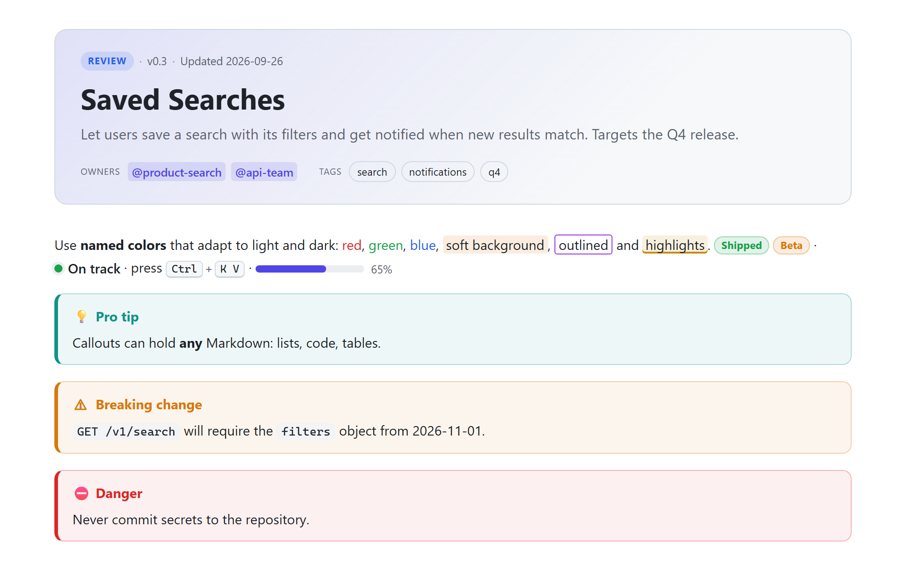
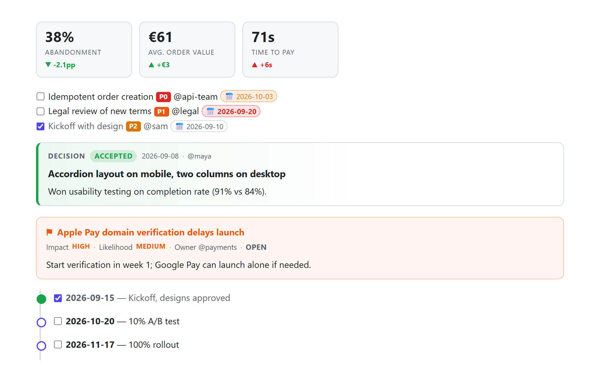
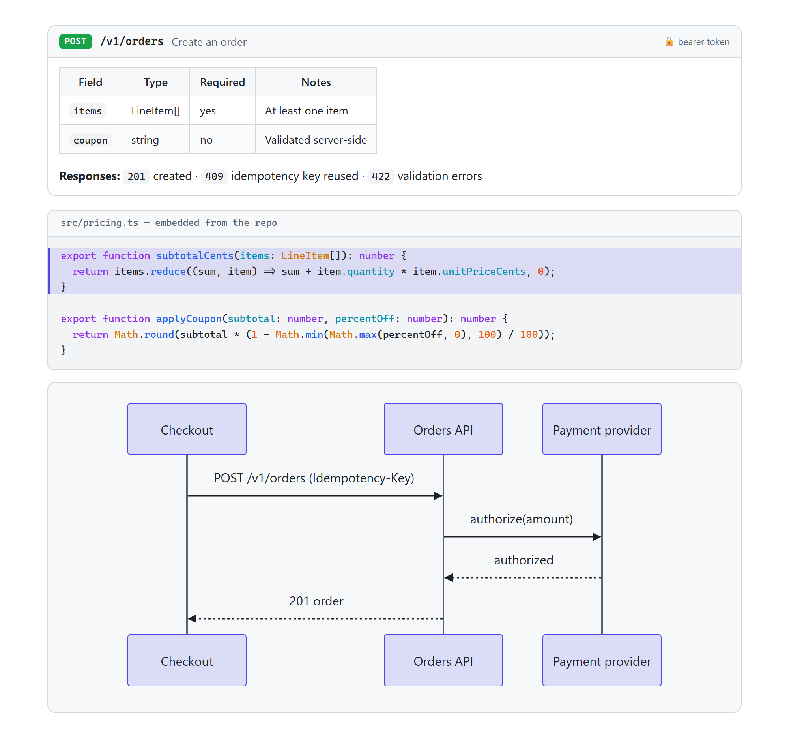
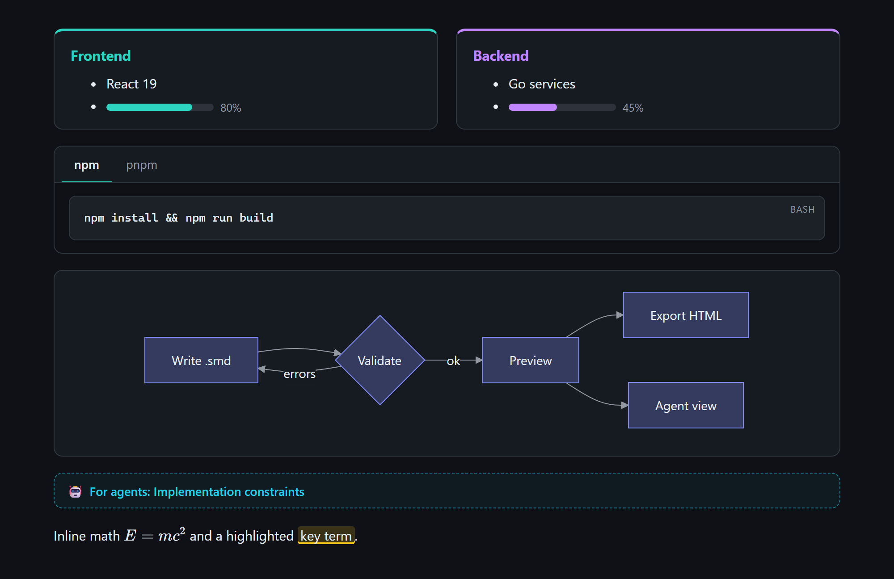
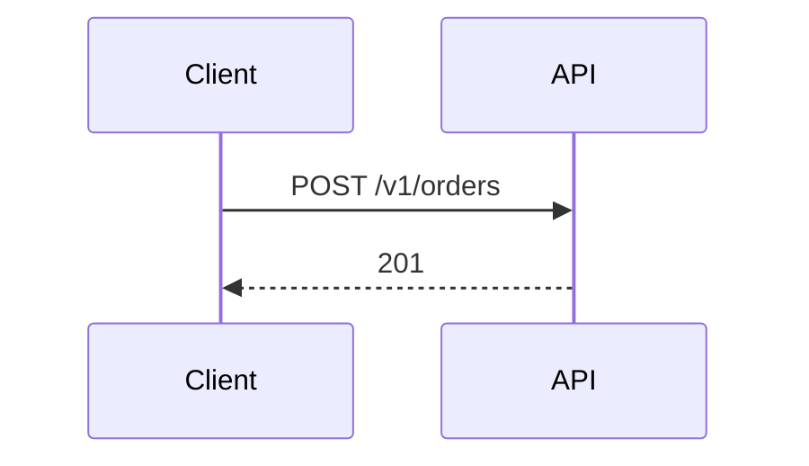

# Styled Markdown feature guide

Every Styled Markdown feature, with its syntax, what it renders, what an AI agent reads (the **agent view**), and what it becomes in plain GitHub Markdown (`smd export --to md`). The formal rules are in [SPEC.md](SPEC.md).

## At a glance

The short version of this guide; each item is described in full in the sections below.

<details open>
<summary><b>Format</b></summary>

| Area | Features |
|---|---|
| **Foundation** | 100% CommonMark + GFM (tables, task lists, autolinks) · YAML front matter with a status header, owners, tags, TOC and accent color |
| **Callouts** | `note` `info` `tip` `success` `warning` `danger` `question`, optionally collapsible · `details` · GitHub alerts (`> [!NOTE]`, `> [!WARNING]`…) render as callouts |
| **Styling** | 14 theme-aware named colors · `[text]{color bg border size weight font style}` · `==highlight==` |
| **Inline** | `:badge` `:status` `:priority` `:due` `:metric` `:progress` `:kbd` `:mention` · inline and display math (KaTeX) · front matter values in text with `{{version}}` |
| **Layout** | `tabs` · `columns` · `card` · `box` · `steps` · `timeline` (nest to any depth) |
| **Project management** | `decision` (ADR records) · `risk` (impact × likelihood) · tasks with owner, priority and due date · overdue detection |
| **Developers** | `api` endpoint blocks · code titles · line highlights `{2,5-7}` · live source embeds `file="…" lines="…"` · shared text included from other documents `:::include{file="…" section="…"}` · syntax highlighting |
| **Diagrams** | Every Mermaid type (flowchart, sequence, gantt, ER, state, class, pie, mindmap, timeline, xychart…), themed to match the document |
| **Audience** | `:::agent` (instructions for AI) · `:::human` (people only) · `## Heading {agent=skip}` |
| **Safety** | No scripts, whitelisted CSS values, sandboxed file embeds and includes, strict Mermaid |

</details>

<details open>
<summary><b>VS Code extension</b></summary>

- **Live preview** (`Ctrl+K V`) with scroll sync, double-click to jump to source, clickable task checkboxes, and light/dark themes
- **[Block Editor (Preview)](#block-editor-preview):** the rendered document, edited one block's source at a time (opt-in through **Open With…**)
- **Validation** as you type, with **quick fixes** (`:::warnign` → `:::warning`, `flowchat` → `flowchart`, `blu` → `blue`), and Mermaid syntax errors on the exact line
- **IntelliSense:** completions for blocks, directives, attributes, allowed values and front matter; paths and `#anchors` in links, `related:` and `file="…"` embeds; hover docs; color picker
- **Go to definition** for `#anchor` and `other.smd#anchor` links, files and reference links
- **Format Document** and format on save, with the same rules as `smd fmt`: container fences, attribute lists, table columns and blank lines
- **Find references** (`Shift+F12`) and **rename** (`F2`) for headings: renaming a heading updates every link to its anchor across the workspace
- **Refactorings** (`Ctrl+.`): wrap a selection in a callout, card, `:::details`, `:::agent` or `:::human`; change a callout's type; convert a `> **Warning:**` or `> [!WARNING]` blockquote into `:::warning`
- **SMD Tasks view** in the Explorer: open tasks from every `.smd` in the workspace, grouped by owner, due date or document, overdue first, with checkboxes that update the file and an overdue badge
- **Document status** in the status bar: click it to move a document from `draft` to `review` to `approved` (or `deprecated`, `archived`); only the front matter `status:` (and `updated:`) changes, as one undoable edit
- **Workspace symbols** (`Ctrl+T`) across every `.smd` heading, decision, risk and API endpoint (`POST /v1/orders`), and **hover previews** of linked sections, linked documents and `file="…"` code embeds
- **Editing comfort:** Enter continues task lists (unchecked, keeping `@owner`), bullets and numbered lists; paste or drop images to save them in `docs/images/` with a relative link; **Set Up Spell Checking** teaches cSpell to skip directives, attributes and code
- **Outline, folding** and **41 snippets** (`prd`-style blocks, `decision`, `risk`, `api`, `figure`, `glossary`, `changelog`, `quote`, `mermaid`, `gantt`, `task`, `embed`, `transclude`…)
- **Agent view** (🤖 button), **brief agent view**, **copy for an agent** (whole doc or picked sections), and a **status-bar token counter**
- **Export** to standalone HTML, plain GitHub Markdown, Confluence, Notion or Word (.docx) · **Convert** `.md` → `.smd` · **Validate workspace** · **Migrate to Spec v2** (and **Preview Migration to Spec v2**)
- **Built-in Markdown preview:** `.md` files that opt in with `smd: 1` in their front matter render `.smd` syntax (callouts, directives, attribute lists, Mermaid, code titles) in VS Code's own preview too; `smd.markdownPreview.enabled` set to `always` does it for every `.md` file, `never` for none

</details>

<details open>
<summary><b>CLI (<code>smd</code>)</b></summary>

| Command | Purpose |
|---|---|
| `smd read <file> [--max-tokens N]` | One call for agents: the whole agent view when it fits the budget (default 2,000 tokens), else the outline and how to read single sections |
| `smd index <dir> [-o catalog.json]` | JSON catalog of every doc (title, summary, status, owners, tags, sections, token costs, open tasks, risks…) so agents pick which docs to read |
| `smd outline <file> [--related]` | Sections with line ranges and token costs; `--related` adds each `related:` doc's title, status, summary and cost |
| `smd agent <file> [--section …] [--brief] [--max-tokens N]` | Compact agent view; `--max-tokens` condenses it and leaves out the least important sections (with pointers) to fit |
| `… --tokenizer o200k_base` | Exact token counts next to the estimate on `outline` and `agent`, if you have installed `js-tiktoken` (OpenAI encodings; approximate for Claude) |
| `smd tasks <dir> [--mine @me]` | Open tasks across docs, overdue first |
| `smd issues <dir> [--apply] [--create] [--close]` | Sync tasks with GitHub Issues through your `gh` login. A dry run unless `--apply`: checks off tasks whose issue closed, `--create` opens issues for unlinked tasks (and links them), `--close` closes issues of done tasks |
| `smd decisions <dir> [--status accepted] [--md]` | Decision log across docs, newest first; `--md -o docs/decisions.smd` writes an ADR index to commit |
| `smd tasks <dir> --csv` · `--gantt [--smd]` | Export tasks to a spreadsheet, or a Mermaid Gantt chart of due dates (`--smd`: a document `smd export --to html` draws) |
| `smd risks <dir> [--html]` | Risk register: every risk scored impact × likelihood, highest first, with a matrix; `--html` for a colour-coded page |
| `smd report <dir> --since <date\|git-ref> [-o status.smd]` | Draft a status report: tasks done and added since, open tasks (overdue and due this week first), decisions since, high-impact risks, linked to their sections |
| `smd query "<selector>" <paths> [--json]` | Decisions, risks, APIs, callouts, tasks or headings by type and attributes, e.g. `risk[impact>=high]` |
| `smd diff <paths> --since <git-ref>` / `smd diff <old> <new>` | Only the sections that changed, in the agent view: catch up on a doc without rereading it |
| `smd validate <paths> [--fix] [--json] [--strict]` | Check files (CI-friendly exit codes); rules configurable in `smd.config.json` / `.smdrc` and with `<!-- smd-disable-next-line code -->`; `--format github` for pull request annotations ([GitHub Action](INSTALL.md#github-actions)) |
| `smd fmt <paths> [--check]` | Format files in place; `--check` fails CI on unformatted files |
| `smd migrate <paths> --to 2 [--dry-run \| --check]` | Migrate docs to spec v2 (`smd: 2`) so each keeps its meaning: only `.smd` files that need it, each written whole or not at all, then checked; the notes it prints are left to you. `--dry-run` reports the plan, `--check` fails CI when a doc still needs it ([steps](SPEC.md#101-migrating-to-spec-v2)); also **Migrate to Spec v2** in VS Code |
| `smd init <file> --template prd` | New doc from 16 templates (`smd templates` lists them), with `smd: 2` |
| `smd export <file> --to <format> [-o out]` | Every export in one command. Without `--to`, the extension of `-o` picks the format (`.html`, `.md`, `.pdf`, `.docx`). The older names `smd render`, `to-md`, `pdf` and `docx` still work |
| `… --to html` · `md` | A standalone page with a print stylesheet (Print → Save as PDF), or plain GitHub Markdown |
| `… --to pdf [--format A4\|Letter] [--landscape] [--browser <path>]` | PDF with diagrams as vectors, printed by an installed Chrome, Edge, Chromium or Brave (or Playwright or Puppeteer, if installed; smd bundles no browser); also **Export to PDF** in VS Code and the JetBrains plugin |
| `… --to docx [--engine builtin|pandoc] [--reference-doc house.docx]` | Word document (Word, LibreOffice, Google Docs) with real headings, lists, tables, footnotes and links, written by smd with nothing to install, or converted by [Pandoc](https://pandoc.org/installing.html) when you have it (Word equations too); also **Export to Word (.docx)** in VS Code and the JetBrains plugin |
| `… --to confluence` · `notion` | A page for your wiki: Confluence storage format (callouts, code, expands, tasks and statuses as built-in macros) or Notion API blocks cut into request bodies. It only writes the file: no network, no credentials ([mapping](#confluence-and-notion-smd-export)) |
| `smd from-md` · `meta` | Upgrade Markdown to `.smd`; a document's full JSON summary |
| `smd build <dir> --out site` | Static docs site: a page per doc, sidebar, breadcrumbs, search, backlinks and a task/decision/risk dashboard |
| `smd mcp [--root <dir>] [--allow-write]` | MCP server for agents: `read`, `tasks`, `query` and `validate` as tools (the older `outline`, `section` and `agent` still answer; `--legacy-tools` lists them); `--allow-write` adds `check_task`, `set_status` and `add_decision` ([setup](AGENTS.md#mcp-server)) |
| `smd lsp --stdio` | Language server for Neovim, Helix, Zed and other LSP editors: diagnostics, quick fixes, outline, hover, completion, go to definition, formatting (also `smd-language-server`; [setup](EDITORS.md)) |
| `smd init --agent claude|cursor|copilot|agents` | Set up an agent in a project in one command: skills or rules, the CLI at `.smd/smd.cjs`, the MCP server config and the `AGENTS.md` snippet |
| `smd skills install [--global] [--target …]` | Install the agent skills, or rules for Cursor, Copilot and `AGENTS.md` |
| `smd savings <dirs> [--json] [--price N]` | Repo-wide token report: raw files vs agent view vs `--brief`, and the saving in tokens and dollars per full read of every document |

**Publish a docs site:** `smd build docs --out site` turns a folder of `.smd` files (and `.md` with `--md`) into a static site in the same folder structure, with links between documents rewritten to pages, a sidebar, previous/next links, backlinks, a search box that works offline, and a dashboard of open tasks, decisions and risks. Open `site/index.html` from disk or upload the folder to any static host (`--base /docs/` for absolute links). It only writes to a new, empty or previously built folder, and `--clean` removes only files of the previous build. See the [feature guide](#publish-a-docs-site-smd-build).

</details>

<details open>
<summary><b>Agent skills</b></summary>

| Skill | What it teaches an agent |
|---|---|
| **`styled-markdown-writer`** | Create and edit `.smd` that follows every rule: choose a template (PRD, ADR, RFC, runbook, API, status report, meeting notes, postmortem, release notes, OKRs, onboarding, test plan, PR description, and spec, plan and tasks for [spec-driven work](SPEC-DRIVEN.md)), fill it, validate with `--fix`, and keep it cheap for agents to read |
| **`styled-markdown-reader`** | Read `.smd` with minimal tokens: `outline` first, then only the relevant sections through the agent view, and raw lines only when editing |

</details>


## Contents

[At a glance](#at-a-glance)

**Format**
1. [Documents and front matter](#1-documents-and-front-matter)
   - [Spec versions: `smd: 1` and `smd: 2`](#spec-versions-smd-1-and-smd-2)
2. [Callouts and collapsibles](#2-callouts-and-collapsibles)
3. [Text styling and colors](#3-text-styling-and-colors)
4. [Inline directives](#4-inline-directives)
5. [Tasks with owners, priorities and due dates](#5-tasks-with-owners-priorities-and-due-dates)
6. [Project blocks: decisions, risks, timelines](#6-project-blocks-decisions-risks-timelines)
7. [Developer blocks: APIs, code, embeds](#7-developer-blocks-apis-code-embeds)
8. [Layout: tabs, columns, cards, boxes, steps](#8-layout-tabs-columns-cards-boxes-steps)
9. [Diagrams and math](#9-diagrams-and-math)
10. [Audience: agent, human, agent=skip](#10-audience-agent-human-agentskip)
11. [Headings, links and anchors](#11-headings-links-and-anchors)

**Tools**

12. [VS Code: preview](#12-vs-code-preview)
13. [VS Code: editing assistance](#13-vs-code-editing-assistance)
    - [Block Editor (Preview)](#block-editor-preview)
14. [VS Code: agent view and token counter](#14-vs-code-agent-view-and-token-counter)
15. [Validation and quick fixes](#15-validation-and-quick-fixes)
16. [Export and conversion](#16-export-and-conversion)
17. [CLI reference](#17-cli-reference)
    - [Collaborating on .smd](#collaborating-on-smd)
18. [Templates](#18-templates)
19. [Web playground](#19-web-playground)

---

## 1. Documents and front matter



```yaml
---
smd: 2
title: Saved Searches
summary: Let users save a search with its filters and get notified when new results match.
status: review            # draft | review | approved | deprecated | archived
owners: ["@product-search", "@api-team"]
tags: [search, q4]
version: 0.3
updated: 2026-09-26
accent: indigo            # accent color for headings, links, mentions
toc: true                 # table of contents
theme: auto               # auto | light | dark
lang: de                  # language of the rendered labels (optional, default English)
typography: true          # smd: 2 only: curly quotes, dashes and ellipses (optional; v1 always has them)
---
```

- **Preview:** a header card with a status pill, version, date, owners and tags, plus an optional table of contents.
- **Agent view:** `# Saved Searches`, one `status: review · owners: … · tags: …` line, and `summary: …`.
- **Tip:** the `summary` is the first thing every agent reads. Make it self-contained.
- **Schema:** keys and values are completed and checked from one JSON Schema, published as [`smd-frontmatter.schema.json`](../extension/schemas/smd-frontmatter.schema.json) and as `styled-markdown/frontmatter.schema.json` on npm for YAML tooling and pipelines. Typing `updated: ` suggests today's date.
- **Status workflow:** in VS Code the status bar shows `status` and changes it, bumping `updated`; see [section 13](#13-vs-code-editing-assistance).
- **Variables:** any key can be shown in the text with `{{key}}`, e.g. `Version {{version}}`; see [Front matter variables](#front-matter-variables).
- **Broken front matter stays visible (2.0):** front matter that doesn't parse, often because the closing `---` was forgotten and a later `---` rule closed it, shows as written in a red "Front matter could not be read" block in the preview, the Block Editor and the exports, and as a `[front matter could not be read]` line with the lines in the agent view, instead of hiding everything above that `---`. `smd validate` reports it as `frontmatter/invalid`. `...` also closes front matter.
- **Staleness:** a live document whose `updated` date is more than 180 days old gets a `frontmatter/stale` hint. Bump `updated` after a review, or set `status: archived`. The threshold is set with `smd.validation.staleAfterDays` or `smd validate --stale-after <days>`, where `0` turns it off.
- **Language:** `lang` sets the language of the labels the renderer adds; see [Localized labels](#localized-labels).

### Spec versions: `smd: 1` and `smd: 2`

The `smd` key is the document's spec version: it picks the rules every tool reads the document with (rendering, the agent view, exports, the validator, `smd fmt`, the Block Editor).

- **`smd: 2`** (or `"2"`) is spec v2. Since 2.0, `smd init`, `smd from-md` and the other writers put it in new documents.
- **`smd: 1`, or no `smd` key,** is spec v1, read as in 1.x; so is every `.md` file. A value that isn't a whole number (`smd: true`, `smd: 1.5`) is read as v1 with a `frontmatter/version` warning, and a newer version (`smd: 3`) with the v2 rules and a warning.
- **`typography: true`** turns typographic quotes, dashes and ellipses on in a spec v2 document. A v1 document always has them and ignores the key.

What readers see differently in a spec v2 document:

| Source | Spec v1 | Spec v2 |
|---|---|---|
| `"quotes"`, `--`, `...`, `(c)` | Curly quotes, dashes, `…`, `©` | As typed, unless `typography: true` |
| `example.com`, `README.md` in text | Links | Text; `https://…`, `www.…` and e-mail addresses are still links |
| `## Returns {ok}` | "Returns" (`#returns`) | "Returns {ok}" (`#returns-ok`) |
| `:abbr[HTML]`, `:Badge[x]` | Text | Directives: `HTML` in a plain span, and a badge (write `\:abbr[HTML]` to keep the text) |
| `version: 2.10`, shown by `{{version}}` and the header | `2.1` | `2.10` |
| `:::include{section="refund"}` with a `## Refunds` heading | Includes it (a part of the heading's text matches) | A missing section (only the id or the whole text match) |

What writers must watch: in spec v2, `$$` display math opens and closes only on a line of its own, a closing fence closes the container opened with as many colons, and `\\` in a quoted attribute value is one backslash. The stricter checks of 2.0 (duplicate attributes, title conflicts, Mermaid syntax, figure `kind`, front matter that can't be read) apply to both versions. Every rule, side by side: [SPEC.md §10](SPEC.md#10-versioning). To move a document: [`smd migrate`](#migrating-to-spec-v2-smd-migrate).

### Localized labels

The words the renderer adds around your text follow the document's `lang:`, a BCP 47 tag. Labels ship in English, German (`de`), Spanish (`es`), French (`fr`), Japanese (`ja`), Portuguese (`pt`) and Chinese (`zh`); regional tags use their language (`pt-BR` → `pt`, `zh-Hant` → `zh`).

```yaml
lang: de
```

| English | `lang: de` |
|---|---|
| Note, Warning (callout titles) | Hinweis, Warnung |
| Figure 2, Table 1 | Abbildung 2, Tabelle 1 |
| 📅 2026-01-15 · overdue | 📅 2026-01-15 · überfällig |
| Owners · Updated 2026-10-01 · draft | Verantwortlich · Aktualisiert am 2026-10-01 · Entwurf |
| Impact **high** · Likelihood **medium** | Auswirkung **hoch** · Wahrscheinlichkeit **mittel** |

- **Covered:** the document header (labels, status and audience), the table of contents title, callout titles and their screen-reader prefix, `:::details`, tabs, `:::agent`/`:::human` labels, decisions and their status, risks (labels, levels, status) and the risk matrix, figure labels and `:ref[…]`, the footnotes heading and back links, include notes, quote attributions, `:priority[high]` and other word priorities, `:due[…]` notes, metric and status-dot words, progress bar names, copy buttons and diagram messages, and the `smd build` site's navigation, search and dashboard.
- **Not translated:** your text, dates and numbers, and anything for agents and tools: the agent view, `smd export --to md` (its figure labels stay "Figure 2"), `smd outline` and validator messages stay English.
- **English stays as it was:** without `lang`, or with `lang: en`, output is byte for byte what it was before 1.6.
- **Other languages:** a well-formed tag without labels (say `lang: ko`) renders English labels but marks the page as that language; `smd validate` reports it as `frontmatter/lang` (info) with the supported list.
- **Fallback for documents without `lang`:** `smd export --lang de` (every format but `md`) and `smd build --lang de` (which also sets the site's navigation; without it the home document's `lang` is used), `renderSmd(text, { lang: 'de' })`, and the markdown-it plugin's `lang` option or `env.lang`.

## 2. Callouts and collapsibles

```markdown
:::warning Breaking change
`GET /v1/search` requires the `filters` object from 2026-11-01.
:::

:::tip{collapsible} Advanced options
Starts collapsed. Use {collapsible=open} to start expanded.
:::

:::details Full log
Collapsed section for long content.
:::
```

| Type | Color | Use for | Agent view | GitHub Markdown |
|---|---|---|---|---|
| `note` | gray | neutral remark | `<note>` | `> [!NOTE]` |
| `info` | blue | background | `<info>` | `> [!NOTE]` |
| `tip` | teal | advice | `<tip>` | `> [!TIP]` |
| `success` | green | done / good | `<success>` | `> [!TIP]` |
| `warning` | amber | caveat | `<warning>` | `> [!WARNING]` |
| `danger` | red | hard constraint | `<danger>` | `> [!CAUTION]` |
| `question` | purple | open decision | `<question>` | `> [!IMPORTANT]` |
| `details` | — | long optional content | `<details>` (omitted with `--brief`) | `<details><summary>` |

### GitHub alerts

GitHub's alert syntax works too: a blockquote whose first line is only `[!NOTE]`, `[!TIP]`, `[!IMPORTANT]`, `[!WARNING]` or `[!CAUTION]` (in any case) renders as the matching callout, so a README-style document looks the same in the preview and on GitHub.

```markdown
> [!WARNING]
> Rotate the keys before you deploy.
```

| Alert | Renders as | Agent view |
|---|---|---|
| `[!NOTE]` | `note` | `<note>` |
| `[!TIP]` | `tip` | `<tip>` |
| `[!IMPORTANT]` | `info` (as `smd from-md` converts it) | `<info>` |
| `[!WARNING]` | `warning` | `<warning>` |
| `[!CAUTION]` | `danger` | `<danger>` |

The callout shows its type as its title (alerts have none of their own). `smd export --to md` keeps the alert as written, and the exports show it as the callout. Anything else stays a blockquote, as on GitHub: text after the marker on its line, an unknown kind, a quote with only the marker, or a quote inside a list item or another quote. Use `:::warning Title` when you want a title or `{collapsible}`. Since 1.10; earlier versions show the quote with its `[!WARNING]` line.

## 3. Text styling and colors

```markdown
[red text]{color=red}  [soft background]{bg=amber}  [outlined]{border=purple}
[big bold]{size=lg weight=bold}  [code-like]{font=mono}  [removed]{style=strike}
[brand color]{color="#0ea5e9"}  ==highlighted==
```

| Attribute | Values |
|---|---|
| `color`, `bg`, `border` | `red` `orange` `amber` `yellow` `green` `teal` `cyan` `blue` `indigo` `purple` `pink` `gray` `muted` `accent`, or `#hex` / `rgb()` / `hsl()` |
| `size` | `xs` `sm` `md` `lg` `xl` `2xl` |
| `weight` | `normal` `medium` `bold` |
| `font` | `sans` `serif` `mono` |
| `style` | `italic` `underline` `strike` |
| `align` (blocks) | `left` `center` `right` |

Named colors are theme tokens tuned for light and dark mode. Only whitelisted values are rendered, so documents can't inject CSS. **Agent view:** plain text. **GitHub:** plain text (bold/italic/strike kept).

- **Quotes in values:** a quoted value can hold its own quote with a backslash, `title="It's \"done\""` or `label='The team\'s share'` (since 1.10). Other backslashes are kept as written (`file="C:\docs\plan.smd"`), except that `\\` is one backslash in an `smd: 2` document.
- **Case:** the values a block or directive takes from a list, and the front matter `status`, `audience` and `theme`, match in any case (`:::decision{status=Accepted}`, `:metric{trend=Up}`, `theme: Dark`) and render as the lower-case value. Style values and named colors match only as written: `color=Red` is an error, with a fix to `red`.

## 4. Inline directives

```markdown
:badge[Shipped]{color=green}   :status[At risk]{color=red}   :priority[P1]   :due[2026-10-15]
:metric[42%]{label="Activation" delta="+3%" trend=up}   :progress{value=65}   :kbd[Ctrl+K V]   :mention[@team]
```

| Directive | Renders | Agent view | GitHub |
|---|---|---|---|
| `:badge[x]{color}` | colored pill | `[x]` | `` `x` `` |
| `:status[x]{color}` | dot + label | `[status: x (ok/warn/bad)]` | `🟢 x` |
| `:priority[P0–P4]` | auto-colored pill (P0 red → P4 gray) | `[P0]` | `**P0**` |
| `:due[YYYY-MM-DD]` | date pill: amber ≤ 7 days, red overdue | `(due …, OVERDUE)` | `📅 …` |
| `:metric[v]{label delta trend good}` | KPI tile; the delta is green when it moves the `good` way | `label: v (delta)` | `**v** label (delta)` |
| `:progress{value color label}` | progress bar | `65%` | `▰▰▰▰▰▰▱▱▱▱ 65%` |
| `:kbd[Ctrl+S]` | key caps | `Ctrl+S` | `<kbd>Ctrl</kbd>+<kbd>S</kbd>` |
| `:mention[@x]` | highlighted mention | `@x` | `@x` |
| `:ref[fig-id]` | the figure's number as a link (see [§9](#figures-and-numbered-references)) | `Figure 2 (fig-id)` | `[Figure 2](#fig-id)` |
| `:abbr[x]{.class color}`, any other name (`smd: 2` only) | `x` in a plain `smd-directive smd-directive-abbr` span, styled as `[x]{…}` is; a `directive/unknown` warning | `x` | `x` |

**Spec v2 (`smd: 2`).** Any `:name[…]` is a directive, so a directive a later release adds shows its content in older 2.x tools, and names are read in any case (`:Badge[x]` is a badge). In documents without `smd: 2`, only the names above, in lower case, are directives; anything else is text. Write `\:abbr[HTML]` to keep a colon as text in either.

### Footnotes

```markdown
Retries are capped at five[^retries], as the SRE review asked[^SRE].

[^retries]: Five covers 99.9% of transient failures in last quarter's logs.
[^sre]: SRE review, 2026-09-12.
    Lines indented by 4 spaces continue the footnote, even across paragraphs.
```

GitHub-compatible footnotes (since 1.6). Labels are numbers or words, matched case-insensitively. The preview numbers footnotes by their first reference and lists them in a section at the end, each with a back link (↩︎) to every reference; hovering `[^retries]` in the editor shows the footnote, and typing `[^` completes the labels. As on GitHub, a definition nothing references is not shown and a reference without a definition stays plain text: the validator reports both (`footnote/unused`, `footnote/undefined`), plus repeated labels (`footnote/duplicate`). **Agent view:** as written, `[^1]` in the text and the definitions where they are; `smd agent --section` adds the definitions a section references but doesn't contain. **GitHub:** unchanged (GitHub renders footnotes).

### Front matter variables

```markdown
---
version: "2.10"
release:
  date: 2026-10-20
---

## What's new in {{version}}

Version {{version}} ships on {{release.date}}. :badge[v{{version}}]{color=indigo}
```

`{{name}}` shows the value of a front matter key (since 1.6): *Version 2.10 ships on 2026-10-20*. Dots reach nested keys (`{{release.date}}`) and list items (`{{owners.0}}`); a whole list shows as `a, b`. Use it for the version, product name, dates or owners you'd otherwise repeat and forget to update. With `smd: 2` values show as written (`version: 2.10` shows `2.10`); in `smd: 1` documents YAML reads `2.10` as the number 2.1, so quote it there (`version: "2.10"`).

- **Where:** text, headings, lists, tables, link text, image alt text, block titles and directive content (`:badge[v{{version}}]`, `:due[{{release.date}}]`). Code, math, URLs, raw HTML and attribute lists keep `{{…}}` as written, and so does the front matter (the header shows the title as written).
- **Literal braces:** a name the front matter doesn't define stays as written, so Handlebars or Jinja examples render as before; `\{{name}}` or a code span keeps the braces even when it is defined. The validator notes undefined names (`variable/undefined`, info, with a fix for a near miss such as `{{verison}}`) and warns about a name that is a mapping (`variable/not-text`).
- **Heading ids** come from the heading as written (`#whats-new-in-version`), so links keep working when the value changes.
- **Editor:** typing `{{` completes the front matter names with their values, and hovering a variable shows its value (VS Code and the language server).
- **Agent view** and **GitHub** (`smd export --to md`): the values, so agents and readers see `2.10`. Older `.smd` tools and plain Markdown show `{{version}}` as written.

## 5. Tasks with owners, priorities and due dates

```markdown
- [ ] Idempotent order creation :priority[P0] @api-team :due[2026-10-03]
- [ ] Legal review of new terms :priority[P1] @legal :due[2026-09-20]
- [x] Kickoff with design @sam
```

- **Preview:** checkboxes are clickable and update the source. Overdue dates turn red.
- **SMD Tasks view** (VS Code Explorer): open tasks from every `.smd` file in the workspace, grouped by owner, due date or document; see [section 13](#13-vs-code-editing-assistance).
- **Problems panel:** open tasks past their due date show a `task/overdue` notice.
- **`smd tasks docs/`** lists open tasks across every document, overdue first, then by priority. `--mine @api-team` filters by owner, `--json` gives machine-readable output, `--csv` and `--gantt` export (below).
- **Tasks are what the preview shows with a checkbox.** A task-shaped line in code, in raw HTML or display math, or one that continues a paragraph (`- [ ] x` indented four spaces under a line of text) is text in the preview and on GitHub, so `smd tasks`, `smd meta`, outlines, the Tasks view and `task/overdue` leave it out too.

```text
docs/checkout.smd:61  [ ] [P1] Server-side validation returns all field errors @api-team (due 2026-09-25, OVERDUE)  — Requirements
docs/checkout.smd:62  [ ] [P0] Idempotent order creation @api-team (due 2026-10-03)  — Requirements
```

- **`smd report docs/ --since 2026-09-01`** drafts a status report from what happened to these tasks since a date or Git revision (see [§6](#6-project-blocks-decisions-risks-timelines)).

### Export: CSV and a Gantt chart

`smd tasks` takes the same filters (`--all`, `--mine`) with one export format, printed or written with `-o <file>`:

- **`--csv`** for spreadsheets. RFC 4180: a header row, then one record per task with CRLF line endings, UTF-8 without a byte order mark (in Excel, open it with *Data → From Text/CSV*). Columns, always in this order: `file,line,done,text,owners,priority,due,overdue,section`. `line` is 1-based, as `smd tasks` prints it (`--json` and the library use zero-based lines). `done` and `overdue` are `true`/`false`, owners are joined with `;`. Fields with a comma, a quote or a line break are quoted, with quotes doubled.
  - **Formula guard:** a field that starts with `=`, `+`, `-`, `@`, a tab or a carriage return gets a leading `'`, so a spreadsheet shows it as text instead of running it as a formula. This includes owners: Excel reads `@maya` as a formula, so the cell is `'@maya;@li`. Use `--json` when a program, not a person, reads the export.
- **`--gantt`** prints a Mermaid `gantt` chart: `dateFormat YYYY-MM-DD`, one `section` per document, and one milestone per task on its due date, named by its text and owners. Done tasks (with `--all`) are marked `done`, overdue ones `crit`. Tasks without a real `YYYY-MM-DD` due date are left out; stderr says how many. `--title "…"` sets the chart title (default `Tasks`).
- **`--gantt --smd`** wraps the chart in a small `.smd` document with a `mermaid` fence, so `smd export --to html` or the preview draws it.

```text
smd tasks docs/ --csv -o tasks.csv
smd tasks docs/ --all --gantt --smd --title "Q4 plan" -o timeline.smd
smd export timeline.smd -o timeline.html
```

```text
gantt
  title Q4 plan
  dateFormat YYYY-MM-DD
  section docs/checkout.smd
    Server-side validation returns all field errors @api-team :crit, milestone, 2026-09-25, 0d
    Idempotent order creation @api-team :milestone, 2026-10-03, 0d
```

Characters Mermaid would misread in a name (`:`, `#`, `;`, `%`) become Mermaid entity codes such as `#58;`, which the chart shows as the character itself. So does the first letter of a name that starts with a Gantt keyword (`title`, `click`, `section`…) or a date.

### Sync with GitHub Issues: `smd issues`

`smd issues docs/` keeps tasks and GitHub Issues in step, through your own [GitHub CLI](https://cli.github.com) (`gh`, logged in with `gh auth login`), so no token passes through smd. **It is a dry run unless you add `--apply`:** it reads the issues' states, prints the plan and changes nothing, on GitHub or on disk.

```bash
smd issues docs/                            # the plan only
smd issues docs/ --apply                    # check off tasks whose issue was closed
smd issues docs/ --apply --create --label backlog   # also open an issue for each open task without one
smd issues docs/ --apply --close            # also close the issue of each done task
```

A task is linked to an issue by a reference anywhere on its line, no new syntax. The first one counts, and references in code spans don't:

```markdown
- [ ] Ship the quote endpoint @api [#123](https://github.com/acme/shop/issues/123)
- [ ] Fix the flaky test https://github.com/acme/shop/issues/124
- [x] Kickoff with design acme/shop#125
```

A bare `#123` is not a link (it is too common in prose), and neither are pull request URLs.

| Task | Its issue | With `--apply` |
|---|---|---|
| open, no link | — | with `--create`: a new issue in `--repo` (default: the current folder's repository, from `gh repo view`); ` [#N](url)` is appended to the task line |
| open | closed as completed | the task is checked off (`- [ ]` → `- [x]`) |
| open | closed as not planned | left alone, listed under "Skipped" |
| done | open | with `--close`: the issue is closed as completed, with a comment pointing to the task |
| done, no link | — | left alone |

- **New issues:** the title is the task text without owner, priority, due date or emphasis. The body names the file, line and section, then owners, priority and due date. Owners are in code spans, so nobody is @-mentioned (an owner like `@api-team` may not be a GitHub user). `--label` adds labels (repeatable or comma-separated; they must exist in the repository).
- **Only the intended lines change:** a check-off changes the box, a new link is appended to the line. A task line that changed since it was read is not touched. Line endings (CRLF) are kept.
- **Idempotent:** a linked task never gets a second issue, and each issue is closed once, so running it again is safe.
- **Polite and stoppable:** one `gh` call at a time. The first failure stops the run; what was done, what failed and what was not run is reported. An issue that can't be read is skipped.
- **Exit codes:** 0 done (or nothing to do), 1 a `gh` call failed or an issue could not be read, 2 usage errors, and when `gh` is missing or not logged in to github.com. `--json` prints the plan or the results as JSON (`actions[]` with `kind`, `status`, `file`, `line`, `text`, `issue`; `skipped[]`; `inSync`).

```text
Dry run: nothing is changed. Add --apply to sync (--create to open issues, --close to close them).

Check off tasks whose issue was closed (1):
  docs/plan.smd:5  Fix the flaky test  acme/shop#120

Open issues for tasks without one in acme/shop (1):
  docs/plan.smd:4  Ship the quote endpoint  (needs --create)

Close issues whose task is done (1):
  docs/plan.smd:6  Kickoff with design  acme/shop#118  (needs --close)

[smd] dry run, nothing changed: 1 task(s) to check off, 1 issue(s) to create (needs --create), 1 issue(s) to close (needs --close); 1 in sync.
```

## 6. Project blocks: decisions, risks, timelines



```markdown
:::decision{status=accepted date=2026-09-08 owner=@maya} Accordion layout on mobile
Won usability testing on completion rate (91% vs 84%).
:::

:::risk{impact=high likelihood=medium owner=@payments status=open} Apple Pay verification delays launch
Start in week 1; Google Pay can launch alone.
:::

:::timeline
- [x] **2026-09-15** — Kickoff
- [ ] **2026-10-20** — 10% A/B test
:::
```

| Block | Attributes | Agent view |
|---|---|---|
| `decision` | `status`: proposed · accepted · rejected · superseded · deprecated; `date`; `owner` | `<decision status="accepted" …> title …</decision>` |
| `risk` | `impact`, `likelihood`: low · medium · high · critical; `owner`; `status`: open · mitigated · accepted · closed | `<risk impact="high" …> title …</risk>` |
| `timeline` | — (checked items show as done) | the list |
| `risk-matrix` | title after the name; no body | `[risk matrix: title — …]` pointer (the risks are already `<risk>` blocks) |
| `changelog` | title after the name; one heading per release | `<changelog title="…">` with `## 1.2.0 (2026-03-01)` entry lines |

Rejected and superseded decisions are struck through in the preview. `smd meta` lists all decisions and risks as JSON.

### Release history: `:::changelog`

```markdown
:::changelog Release history
## 1.2.0 — 2026-03-01
- Added CSV export
- Fixed the date picker in Safari

## [1.1.0] - 2026-01-15
### Added
- Dark theme
:::
```

- Each heading directly inside the block is a release: the version, a separator (` — `, ` – ` or ` - `) and the date as `YYYY-MM-DD`; `## Unreleased` (no date) is fine. Write releases **newest first**, as on GitHub and in Keep a Changelog (whose `## [1.1.0] - 2026-01-15` headings and `### Added` subsections work as they are).
- It renders as a timeline: one dot per release, the version, then the date as `<time datetime="2026-03-01">`, then its notes. The headings stay headings, with the same ids and outline entries as anywhere else (`#120-2026-03-01`), so links to them keep working.
- The validator warns about a date that isn't a real `YYYY-MM-DD` date (`changelog/date`, with a fix for `2026/3/1`), a version listed below an older one (`changelog/order`, versions compared as semantic versions, pre-releases before their release) and a version listed twice (`changelog/duplicate`).
- **Agent view:** `<changelog title="Release history">`, each release as `## 1.2.0 (2026-03-01)  [L2]` followed by its notes. **GitHub** (`smd export --to md`): a bold title, then the headings and lists as written. `smd query changelog` finds the blocks; snippet `changelog`.
- Older `.smd` tools (1.5 and earlier) show the headings and lists in a plain box, with a `container/unknown` warning.

### Risk register and risk matrix

Each risk is scored **impact × likelihood**, each level ranked `low` 1, `medium` 2, `high` 3, `critical` 4, so a score runs from 1 to 16. A missing or unknown level counts as `medium` (the spec's default impact) and is flagged, and a risk without `status` is `open`.

**`:::risk-matrix`** draws an impact × likelihood grid of the risks in the same document, cells coloured green → red by score and listing their risks (a risk with an `{#id}` links to its block). Closed risks are left out. In plain Markdown (`smd export --to md`) it becomes a table, and in the agent view a one-line pointer.

```markdown
:::risk-matrix Launch risks
:::
```

**`smd risks`** is the register across documents: one line per risk, highest score first (then impact, then path and line), followed by a matrix of counts. Closed risks are left out unless `--all`; `--status open,accepted` and `--owner @name` filter, `--json` gives the register for tools, and `--html` a standalone page (light/dark) with the colour-coded matrix linking to the register table (`-o risks.html` writes it to a file).

```bash
smd risks docs/
smd risks docs/ --status open --owner @payments
smd risks docs/ --html -o risks.html
```

```text
docs/checkout.smd:145  [6] high×medium  Apple Pay domain verification delays launch  @payments  open  — Risks  → Verification needs the production domain and a certificate from the PSP.
docs/plan.smd:40  [4] medium?×medium?  Nobody has scored this yet  open  — Launch  → Impact and likelihood are missing.

impact ↓ likelihood →       low    medium      high  critical
critical                      ·         ·         ·         ·
high                          ·         1         ·         ·
medium                        ·         1         ·         ·
low                           ·         ·         ·         ·
```

`--json` prints `{ risks: [{ path, line, title, id?, impact, likelihood, score, owner, status, section, summary, defaulted }], matrix: { impact, likelihood, counts }, documents, documentsWithRisks }`; `line` is zero-based and `defaulted` lists the levels that were not set. The summary is a `Mitigation:` line from the body when there is one, else the body's first sentence.

**`smd query`** selects blocks across documents by type and attributes, and prints each one in the agent view (`--titles` for one line per block, `--json` for tools):

```bash
smd query "decision[status=accepted]" docs/
smd query "risk[impact>=high][status!=closed]" docs/
smd query "api[method=POST|PUT], question" docs/
smd query "task[owner=@api-team][due<today][done=false]" docs/
```

```text
docs/checkout.smd:145-147  risk  Apple Pay domain verification delays launch  {impact=high likelihood=medium owner=@payments status=open}  — Risks
```

| Selector part | Meaning |
|---|---|
| `decision`, `risk`, `api`, `warning`, … | Any container type. `callout` is any callout, `task` a task item, `heading` a heading with its section, `*` (or nothing) any block. `a, b` lists alternatives. |
| `[key]` | The attribute is set (and not `false`) |
| `[key=a\|b]` `[key!=v]` | Equals one of the values / none of them. Case-insensitive; a leading `@` is ignored. |
| `[key*=v]` `[key^=v]` `[key$=v]` | Contains / starts with / ends with |
| `[key<v]` `<=` `>` `>=` | Numbers, dates (`YYYY-MM-DD` or `today`), priorities (`P0` < `P1` …, `critical` = `P0`, `high` = `P1`) and risk levels (`low` < `medium` < `high` < `critical`) |

Every block also has `title`, `section` (the heading it sits under) and `type`. Defaults count: a decision without `status` is `proposed` and a risk without `impact` is `medium`. Tasks have `done`, `overdue`, `owner`, `priority` and `due`; headings have `level` and `id`. A misspelled type or attribute is an error with a suggestion, and the exit code is 1 when nothing matches.

**`smd decisions`** is the decision log across documents (an ADR index): every `:::decision`, newest date first and undated last, one line each with its location, date, status, title, owner and document › section:

```bash
smd decisions docs/                                   # everything
smd decisions docs/ --status accepted                 # binding decisions
smd decisions docs/ --status open --owner @maya       # still to decide (open = proposed)
smd decisions docs/ --md -o docs/decisions.smd        # an ADR index to commit
```

```text
docs/adr-0007-event-bus.smd:11  2026-09-18  [accepted]  Publish order events to AWS EventBridge  @platform  — ADR-0007: Use a managed event bus for order events
docs/checkout.smd:139  2026-09-11  [rejected]  Build our own wallet integration  @maya  — Checkout Redesign › Decisions
docs/adr-0007-event-bus.smd:44  2026-06-02  [superseded]  Add a retry queue in front of each HTTP consumer  @platform  — ADR-0007: Use a managed event bus for order events › Consequences
```

- `--status` takes a comma-separated list (`accepted,proposed`) of `proposed`, `accepted`, `rejected`, `superseded`, `deprecated`, or `open` for `proposed`. A decision without a status is `proposed`. `--owner @name` keeps decisions whose `owner` includes that name.
- `--json` prints one object per decision: `title`, `status`, `date`, `owner`, `path`, `line` and `endLine` (zero-based), `section`, `anchor` (the decision's `{#id}`, else its section's heading id), `document` (the document's title) and `adr`. `adr` is `true` for a document's own decision, as in an ADR: its first decision, when the document is tagged `adr` or the decision comes before any `##` section.
- `--md` prints an ADR index: front matter and a table of date, status badge, decision, owner and document, with each decision linked to its section (an ADR's own decision to its document) and rejected, superseded and deprecated ones struck through. Links are relative to the `-o` file (to the working directory without `-o`), so the index passes `smd validate` and `smd fmt --check`; `--title` sets its title. Regenerate it instead of editing it.

**`smd report`** drafts a status report (the `status-report` template) from how tasks and decisions changed since a Git commit, branch or tag, or a date:

```bash
smd report docs/ --since 2026-09-01 -o docs/status-2026-09-30.smd     # since the last commit before Sep 1
smd report docs/ --since v1.3.0 --title "Checkout squad"             # since a tag, to stdout
```

```text
[smd] Status report since 2026-09-01 (c1802c4) from 4 file(s): 5 done, 3 new, 1 removed; 9 open, 1 overdue, 2 due soon; 2 decision change(s), 1 high-impact risk(s).
```

- The draft has a **Summary** (status, progress and counts, with a line for you to replace; the front matter `summary` too), **Done since** (tasks that went from `[ ]` to `[x]`, and new tasks already done), **New since**, **Removed since** (only when tasks disappeared), **Open tasks** split into *Overdue*, *Due in the next 7 days* and *Other open tasks* (by priority), **Risks and blockers** (open risks with impact high or critical), **Decisions since** (new decisions, and ones whose status changed), **Decisions needed** (proposed decisions) and **Sources**. Each item links to its section (`docs/plan.smd#rollout`), relative to the `-o` file.
- `--since` takes a Git revision, or a date `YYYY-MM-DD` that means the last commit before that day (`git rev-list -1 --before=<date> HEAD`); the earlier version of each file is read with `git show`, and documents deleted since count too. Before the first commit, every task is new.
- Tasks have no ids, so a task is the same task when its document and text match (ignoring case and spacing); its owner, priority and due date may change. A reworded task shows up as removed and added. Decisions are matched by document and title the same way.
- Without Git history (outside a repository), `--since` a date reports the current state only and the draft says so; `--since` a revision is an error.
- Items are plain list entries, not tasks, decisions or risks of their own, so the report doesn't add to `smd tasks` or `smd decisions`, and it passes `smd validate --strict` and `smd fmt --check`. `-o` never overwrites a file: the draft is for you to edit. `--today` sets the date for overdue and due-soon tasks and the title.

## 7. Developer blocks: APIs, code, embeds



````markdown
:::api{method=POST path="/v1/orders" auth="bearer token"} Create an order
| Field | Type | Required |
| --- | --- | --- |
| `items` | LineItem[] | yes |

**Responses:** `201` created · `409` idempotency key reused
:::

```ts title="src/retry.ts" {2,4-5}
…code…
```

```ts file="../src/pricing.ts" lines="7-13"
```
````

| Feature | Details |
|---|---|
| `:::api` | Method badge (GET blue, POST green, PUT/PATCH amber, DELETE red…), path, auth. `method` and `path` are required. Agent view: `API POST /v1/orders — Create an order (auth: bearer token)`. |
| `title="…"` | File-name header on a code block |
| `{2,4-5}` | Highlighted lines (with `lines=`, the numbers refer to lines of the embedded file) |
| `file="…" lines="a-b"` | Embeds real source, so docs never drift from code. The preview refreshes on save, and the validator reports missing files or out-of-range lines. For safety, only files inside the workspace or the document's folder can be embedded. Agent view: `[code: path lines a-b — read that file]` (inline it with `--embed`). |
| Highlighting | 35+ languages (highlight.js), with a copy button on hover |

### Include another document: `:::include`

Write shared text once (terms, a glossary, a setup section) and include it wherever it is needed:

```markdown
## Pricing

:::include{file="shared/terms.smd" section="Pricing" level=3}
See [Pricing](shared/terms.smd#pricing) in the shared terms.
:::
```

| Attribute | Meaning |
|---|---|
| `file` | The document to include, relative to this one. Its body is included, without the front matter. |
| `section` | Only this section (with its subsections): a heading's id or its whole text, in any case. With `smd: 2` nothing else matches; `smd: 1` documents also match a part of a heading's text, like `smd agent --section`. |
| `level` | The level its top heading becomes, here `###` under `## Pricing`; the other headings move with it. |

- **The body is the fallback.** It shows only where the file can't be included (and in tools before 1.6, which render the block as a plain box), so a link to the file is a good body.
- **Same rendering.** Included text is parsed like the rest of the document: every block and nested includes work, and links, images and code embeds in it still point where they did from their own folder. A subtle rule in the margin shows its extent on hover.
- **Ids stay stable.** The document's own heading ids never change; included headings are numbered where they would clash (`#pricing-1`), and the document may link to them.
- **Safe.** Files are read with the same sandbox as code embeds (the workspace, the document's folder, its Git repository; the MCP server's root). Cycles (`a → b → a`) stop with a note, includes nest at most 8 deep, and a document includes at most 200 times and 2,000,000 characters.
- **Everywhere it reads.** The preview (it refreshes when the included file is saved), `smd export` (`html`, `pdf`, `docx`, `confluence` and `notion`), `smd build` and the markdown-it, remark and rehype plugins (given a `readFile`) include. The agent view shows the text in `<included file="shared/terms.smd" section="Pricing">…</included>` (`smd agent --no-includes` shows a one-line pointer instead), and `smd export --to md` inlines it, since GitHub can't include. `smd outline`, `query`, `tasks`, `decisions`, `risks`, `index` and `diff` work per file.
- **Editor help.** Completion of paths in `file="…"`, go to definition on the path, hover preview of the included document, the `transclude` snippet, and warnings for a missing file or section, a file outside the workspace, cycles and limits (`include/*`).

## 8. Layout: tabs, columns, cards, boxes, steps



```markdown
::::columns
:::column{width=60%}
:::card{accent=teal} Frontend
- React 19
:::
:::
:::column
Right side
:::
::::

::::tabs
:::tab npm
npm install
:::
:::tab pnpm
pnpm install
:::
::::

:::steps
1. Install
2. Configure
:::

:::box{bg=indigo align=center}
Any styled block.
:::
```

Nesting works at any depth. Write each closing fence with as many colons as its opener, as `smd fmt` does: in an `smd: 2` document a closing fence closes the innermost block opened with that many colons (and any block left open inside it), so a missing `:::` inside `::::tabs` no longer swallows the rest of the document; a fence whose count no open block has closes the innermost one (`container/colons`). In spec v1 any closing fence closes the innermost block, so the extra colons on outer blocks are only for readability. A `:::` inside a code block or `$$` display math never closes a block. Columns stack on narrow screens. **Agent view:** layout wrappers disappear and tab labels become `Tab "npm":`.

**Unknown containers** (a misspelt name, or a container from a newer version) render as a box with their content and keep their title: `:::frobnicate Release notes` shows **Release notes** as a card-style title in the box, a `Release notes:` line in the agent view and a `**Release notes**` paragraph in `smd export --to md`, and the validator warns `container/unknown` with the closest known name. Before 1.10 the title was dropped. A `:::box` takes no title, as before.

## 9. Diagrams and math

````markdown


Inline $E = mc^2$ and display:

$$
\int_0^1 x^2\,dx = \frac{1}{3}
$$
````

- **Mermaid:** every type is supported, colored from the document palette, and follows light/dark mode. The validator catches unknown diagram types (`flowchat` → `flowchart`).
- **Math:** KaTeX, inline and display, with syntax errors reported. `$5 and $10` stays plain text. Put a display block's `$$` delimiters on lines of their own (or `$$ x $$` on one line): in an `smd: 2` document only such lines open and close it, so `$$5 per seat` is text. Display math is opaque, like code: a `:::` line inside it never closes the container around it.
- **Agent view:** diagrams are kept (they're compact); `--brief` turns them into `[diagram: sequenceDiagram, 4 lines — see L10-L15]`. Code (fenced and indented) and math (`$…$` and `$$` blocks) stay exactly as written in the agent view and `smd export --to md`: no directive, styled span or `{{variable}}` inside them is converted.

### Figures and numbered references

````markdown
Orders move through the states in :ref[fig-states]; the limits are in :ref[tbl-limits].

:::figure{#fig-states} Order states
```mermaid
stateDiagram-v2
  [*] --> Pending --> Paid
```
:::

:::figure{#tbl-limits kind=table} Rate limits per plan
| Plan | Requests per minute |
| ---- | ------------------- |
| Free | 60                  |
:::
````

- **`:::figure`** puts a caption under an image, diagram, table or code block, numbered in document order: *Figure 1: Order states*. `kind=table` counts *Table 1, 2…* separately (its caption sits above the table) and `kind=listing` *Listing 1, 2…* for code.
- **`:ref[id]`** shows the figure's number as a link (*Figure 1*), before or after the figure and in titles. Numbers are computed, so they stay right when figures move.
- The validator warns about a `:ref` to an id no figure has (`figure/unknown-ref`, with a fix for a near miss) about two figures with one id (`figure/duplicate-id`) and reports an unknown `kind` as an error (`attrs/value`, with a fix; the warning `figure/kind` before 2.0).
- **Agent view:** `<figure id="fig-states"> Figure 1: Order states` … `</figure>`, and references read `Figure 1 (fig-states)`, so an agent can find the figure by id. **GitHub** (`smd export --to md`): an `<a id>` anchor, the content and a `**Figure 1:** Order states` line; references become `[Figure 1](#fig-states)` links.
- Older `.smd` tools (1.5 and earlier) show a figure's content in a plain box without the caption, with a `container/unknown` warning, and `:ref[…]` as written.

### Glossary and abbreviations

```markdown
Every API call counts against the SLO. When the error budget is spent, deploys stop.

:::glossary Glossary
- **API**: Application Programming Interface
- **SLO**: Service level objective: the target share of good requests
- **Error budget**: How much unreliability the SLO allows in a period
:::
```

- **`:::glossary`** renders its `- **Term**: definition` list as a definition list, each term with its own anchor (`#term-api`, `#term-error-budget`).
- **Hover definitions:** the first use of each term in every section (between two headings) gets a dotted underline, shows its definition on hover and links to it, so keyboard and screen-reader users reach it too. Abbreviations are `<abbr title="…">`. Later uses in the same section stay plain, so paragraphs don't fill with underlines.
- **Matching:** whole words only. An abbreviation (capitals, no lower-case letters: `API`, `SLO`, `P99`) matches exactly as written; other terms also match with a small or capital first letter (`Error budget`, `error budget`). Headings (their ids never change), code, math, links, URLs and attribute values are left alone, and so are `API-first` and `API.md`. Straight and typographic quotes and dashes are the same for matching, so `Builder's rule` is found whether the text shows `Builder's` or `Builder’s`, with typography on or off.
- The validator warns about list items in a glossary that aren't `**Term**: definition` (`glossary/entry`: that list then renders as a plain list) about terms defined twice (`glossary/duplicate`) and about a term whose id `term-…` a heading or another element also has (`glossary/duplicate-id`), and notes terms never used (`glossary/unused`, info).
- **Agent view:** `<glossary title="Glossary">` with the entries as written, once; uses in the text are not expanded, so they cost no extra tokens. **GitHub** (`smd export --to md`): a bold title and the list as it is.
- **Includes and footnotes:** included text counts as part of the document both ways: `:::include` a shared glossary to use its terms, and the document's terms are marked in included text too. Footnotes are never marked.
- **Editor:** hover a term anywhere in the text, or in its entry, to see its definition (VS Code and the language server; the document's own glossaries); the `glossary` snippet starts a block.
- Older `.smd` tools (1.5 and earlier) show the list in a plain box with a `container/unknown` warning, and the terms as plain text.

### Quotes with attribution

```markdown
:::quote{author="Ada Lovelace" source="Notes on the Analytical Engine" cite="https://example.com/notes"}
The Analytical Engine weaves algebraic patterns just as the Jacquard loom weaves flowers and leaves.
:::
```

- Renders as `<figure class="smd-quote">` with the body in a `<blockquote cite="…">` and the attribution below: "— Ada Lovelace, *Notes on the Analytical Engine*" (`<figcaption>— Author, <cite>Source</cite></figcaption>`). The source links to `cite` when both are given. A quote is never numbered as a figure, so `:ref[…]` and figure numbers ignore it.
- `cite` must be an `http(s)` or relative URL; anything else (`javascript:`, `data:`, `mailto:`) is left out and reported (`quote/cite`). The validator also warns about a quote with no text (`quote/empty`) or no `author` (`quote/author`).
- **Agent view:** `<quote author="Ada Lovelace" source="…" cite="…">` … `</quote>`. **GitHub** (`smd export --to md`): a blockquote ending with a `— Ada Lovelace, *[Source](url)*` line. `smd query 'quote[author*=lovelace]'` finds quotes; snippet `quote`.
- Older `.smd` tools (1.5 and earlier) show the text in a plain box without the attribution, with a `container/unknown` warning.

## 10. Audience: agent, human, agent=skip

```markdown
## Background {agent=skip}
History and research. People see a "humans only" tag; agents skip the section.

:::human Thanks
People-only content anywhere in the document.
:::

:::agent Engineering constraints
- All prices are integer cents.
- If the open question is unresolved, show wallet buttons after the email field.
:::
```

| Construct | Preview | Agent view |
|---|---|---|
| `:::agent` | Collapsed "For agents" panel (configurable) | `<agent-instructions>`, **always included**, even when only one section is requested |
| `:::human` | "For humans" panel | omitted (unless `--include-human`) |
| `## … {agent=skip}` | "humans only" tag on the heading | whole section omitted |

An `:::agent` block inside a section marked `{agent=skip}` is omitted with the section, so agents never read it; the validator warns about it (`container/agent-in-skip`).

## 11. Headings, links and anchors

- `## Title {#custom-id}` sets a stable anchor, and `{.lead}` adds a class (`{.page-break}` starts a new page when printed: [section 16](#pdf-and-printing)).
- Headings get automatic ids, so `[see API](#api)` works. Broken anchors and missing relative files are reported. How ids are made is in [SPEC.md §4.2.3](SPEC.md#423-heading-ids).
- **GitHub ids** work too. GitHub keeps `_` and doesn't collapse hyphens, so `## max_tokens` is `#maxtokens` here and `#max_tokens` on GitHub. A link by the GitHub id is accepted, with an info note and a quick fix to `#maxtokens` (it doesn't work in the preview), and go to definition, hover, find references and rename follow it. `smd export --to md` writes `<a id="maxtokens"></a>` before such headings, so links by either id work on GitHub; `smd from-md` drops those lines again.
- The outline view and folding follow headings and blocks.

---

## 12. VS Code: preview

| Feature | How |
|---|---|
| Open preview | `Ctrl+K V` (side) · `Ctrl+Shift+V` (current tab) · preview icon in the title bar |
| Live update | Updates as you type; embedded source files refresh on save. Updates keep your place: the same content stays at the top even when you add lines above it, unchanged Mermaid diagrams aren't redrawn, and the selected tab and opened/closed collapsibles stay as you left them, also after the preview tab was hidden. |
| Scroll sync | The preview follows the editor. **Double-click** in the preview to jump to that line. |
| Task toggling | Click a checkbox in the preview to update the source |
| Theme | Follows VS Code light/dark/high contrast. Override with `smd.preview.theme` or front matter `theme:`. |
| Security | A strict Content Security Policy: scripts in documents never run |

**`.md` files in VS Code's built-in preview.** A `.md` file that opts in with an `smd` front matter key (`smd: 1` or `smd: 2`) renders its `.smd` syntax in VS Code's own Markdown preview too (`Ctrl+Shift+V` on a `.md` file): containers, inline directives, attribute lists, `==marks==`, Mermaid diagrams (drawn in the preview's theme), and code titles, line highlights and `file="…"` embeds. Plain Markdown looks as before, and code blocks without `.smd` attributes keep VS Code's highlighting. Compared with the `.smd` preview:

- math is VS Code's own while `markdown.math.enabled` is on (the default); with it off, the `.smd` math rules apply
- task lists, the front matter header and the table of contents are left to VS Code, and tabs show one after another
- `smd.markdownPreview.enabled` says which `.md` files get it: `opt-in` (the default since 2.0: only files with an `smd` key), `always` (every `.md` file, as in 1.x; `true` still means this) or `never` (`false`); settings apply after **Developer: Reload Window**

## 13. VS Code: editing assistance

| Feature | How |
|---|---|
| Syntax highlighting | Blocks, attributes, directives, math and front matter |
| Completions | After `:::` (blocks, with snippets for tabs/columns), `:` (directives), `{` (attributes), `=` (allowed values: colors, statuses, HTTP methods…), front matter keys and values, Mermaid types, front matter names with their values after `{{`. In links (`](…`, `[label]: …`), `related:` entries, `file="…"` embeds and `:::include{file="…"}`: relative files and folders, then after `#` the headings and ids of this or the linked document |
| Hover | Documentation for blocks and directives; the definition of a glossary term; the value of a `{{variable}}` |
| Color picker | Swatches next to `color=`, `bg=`, `border=`, `accent:` |
| Outline & folding | Headings in the Outline view; fold blocks, code and front matter |
| Go to definition | `F12` or `Ctrl+Click` on `#anchor`, `other.smd#anchor`, a relative file, a `related:` entry or a `[text][label]` reference jumps to the heading, `{#id}` block, file or definition |
| Format Document | `Shift+Alt+F` or format on save applies the `smd fmt` rules: container fence colons by nesting level, canonical attribute lists, aligned tables, blank lines around blocks. Layout only; the rendered document never changes |
| Find references | `Shift+F12` on a heading, or on the `#anchor` of a link, lists the heading and every link to it in the workspace's `.smd` and `.md` files |
| Rename heading | `F2` on a heading renames it and updates every `#anchor` and `other.smd#anchor` link to it across the workspace, including the numbered anchors of later headings with the same text. Headings with an explicit `{#id}` keep their anchor, so links are left alone. Links by the heading's GitHub id (`#max_tokens`) follow it too |
| Refactorings | `Ctrl+.` with a selection wraps it in `:::note`, `:::tip`, `:::warning`, `:::danger`, `:::card`, `:::details`, `:::agent` or `:::human` (a selection that splits a code block or container isn't offered). On a callout's opening line: convert it to another callout type. In a blockquote that starts with `[!NOTE]`-style alerts or a bold label (`**Warning:**`, `**Tip**:`…): convert it to the matching callout |
| SMD Tasks view | In the Explorer of any workspace with `.smd` files: the open tasks of every `.smd` file. **Group Tasks By…** in the view's title bar switches between owner (Unassigned last), due date (Overdue, Today, This week, Later, No due date) and document, and is remembered per workspace. Inside each group: overdue first, then priority, then due date. Each task shows its priority, due date and owners; hover for its section and file. Click to open it at its line; tick the checkbox to check it off in the file (saved unless it had unsaved changes). The eye button shows completed tasks too; the badge counts overdue tasks. Updates as you type, save, and create or delete files |
| Document status | The status bar shows the front matter `status` of the active `.smd` file (`Draft`, `Review`, `Approved`, `Deprecated`, `Archived`, each with its icon), **No status** when there is none, and a warning for a value outside the five. Its tooltip says **Styled Markdown spec v2** for a document with `smd: 2`. Click it, or run **Set Document Status…**, to pick a status: the usual next step (draft → review → approved → deprecated → archived) comes first, the current one is marked, and each says what it means to readers. Only the front matter changes, as one undoable edit that is not saved: the `status:` value is replaced in place (quotes and comments kept), or a `status:` line is added after `summary:` (else `title:`, else at the end); a file without front matter gets `smd: 2` and `status:` (since 2.0; `smd: 1` when spec v2 would show it differently, e.g. it has quotes the typographer curls, so its rules never change). An existing `updated:` is set to today (`smd.status.updateDate`). Front matter that does not parse is left alone |
| Workspace symbols | `Ctrl+T` searches every `.smd` in the workspace: headings, `:::decision` and `:::risk` titles, and `:::api` endpoints by method and path (`post orders` finds `POST /v1/orders — Create an order`) |
| Hover previews | Hover a link's text or target: `#anchor` and `other.smd#anchor` show the start of that section, `other.smd` shows its title, status, summary and sections. Hover a ```` ```ts file="…" lines="…" ```` line to see the embedded code |
| Lists on Enter | Enter on `- [x] Ship it @maya` starts `- [ ] ` with the cursor before ` @maya`. Bullets repeat, numbers count up, Enter on an empty item ends the list, and code blocks are left alone (`smd.editor.continueLists`) |
| Images | Paste an image, or drop image files, to save them in `docs/images/` (`smd.images.folder`) and insert ``. Images already in the workspace are linked where they are; name clashes get `-1`, `-2`… |
| Spell checking | **Set Up Spell Checking (cSpell)** adds an `smd` entry to cSpell's `languageSettings`, so container and directive names, attribute lists, `@mentions`, link targets, front matter and code aren't flagged; titles and link text still are |
| Snippets (41) | `frontmatter` `callout` `details` `card` `tabs` `columns` `steps` `agent` `human` `decision` `risk` `risk-matrix` `api` `timeline` `figure` `ref` `glossary` `changelog` `quote` `task` `priority` `due` `metric` `badge` `status` `progress` `kbd` `mermaid` `sequence` `gantt` `pie` `math` `code` `embed` `skip` `table` `tasks`… |

### Block Editor (Preview)

An optional editor for `.smd` files (since 1.8): the document as the preview renders it, edited one block at a time. It works on the same document as the text editor, so save, undo, the unsaved-changes dot, Git diffs and Problems work as usual, and only the lines of the block you edit change: nothing is reformatted. It is a preview, so its look and keys may change in minor releases. On macOS, use `Cmd` where this says `Ctrl`.

| Task | How |
|---|---|
| Open and close | Right-click a `.smd` file or its tab → **Open With…** → **Styled Markdown Block Editor (Preview)**, or run **Styled Markdown: Open Block Editor**. **Styled Markdown: Reopen in Text Editor** (also an icon in the title bar) goes back. It is never the default editor |
| Edit a block | Click it, or press `Enter` (or `F2`), to edit its Markdown source in place. What you type goes into the document when you pause, leave the block, press `Ctrl+Enter` (done) or save; `Escape` puts the block back as it was when you started. If a text editor changes the block meanwhile, your text is kept and you choose which version stays |
| Undo | In a block's text box (and the form's text fields), `Ctrl+Z` and `Ctrl+Y` undo and redo your typing there. Elsewhere `Ctrl+Z` undoes the document, as in the text editor: each written edit, insert, move, delete or fix is a step. **Edit → Undo** always undoes the document |
| Move around | `↑` `↓` go from block to block, into callouts, tabs and other containers too; `Home` `End` go to the first and last |
| Toolbar | **Insert…** (`Ctrl+/`: the snippet templates, inserted after the current block), **Move up** and **Move down** (`Alt+↑` `Alt+↓`), **Delete**, **Properties**, **Problems…**, **Edit in text editor** and, for a document without one, **Add front matter** |
| Container attributes | With a container selected, **Properties** sets its title and attributes in a form, such as a risk's impact or a callout's color |
| Tasks | Task checkboxes tick as in the preview |
| Problems and quick fixes | Each block shows a badge with its problem count, blocks inside containers too: a problem counts on the innermost block that holds its line, and a container's badge counts its fences and the lines in it that render nothing. Click the badge, press `Ctrl+.` or choose **Problems…** to list them with the quick fixes VS Code has for them; choose one to apply it as the light bulb would. A fix that also changes other lines or files asks first, and `Ctrl+Z` undoes it |
| Inline items | Click a `:badge`, `:status`, `:priority`, `:progress`, `:due`, `:metric`, `:kbd` or `:mention`, or a styled `[text]{…}` span (from the keyboard, `Tab` from the block to the item and `Enter`), to change it in a small form: its text, a date picker for `:due`, a list for values with fixed choices such as `:priority`, and the named colors (`color`, plus `bg` and `border` on spans). In an `smd: 2` document a directive outside the vocabulary (`:abbr[HTML]`) gets a generic form: its text, color, background and border. `Enter` applies and `Escape` cancels. Only that item's own text changes; an item the form can't change safely (one over two lines, say) opens the block's source instead |
| Tables | Press `Enter` on a table, click a cell or choose **Edit as grid** to edit it cell by cell, also inside a container. Arrow keys and `Tab` move between cells, `Enter` writes the cell and goes down, `Escape` undoes the cell or closes the grid. The grid's toolbar adds a row above or below and a column left or right, deletes a row or column, sets a column's alignment and has **Align table** (`smd fmt`'s table layout, for that table only). Only the cell you edit changes, nothing is realigned unless you ask, and a pipe you type is written escaped. `F2` and **Edit** edit the table's source; a table whose rows have more or fewer cells than the header opens there |
| Front matter | Select it and choose **Properties**: text fields for `title`, `summary`, `version` and `lang`, lists of choices for `status`, `audience`, `theme`, `accent`, `toc`, `typography` and `smd`, date pickers for `updated` and `created`, and comma-separated `owners`, `tags` and `related`. Only that key's value changes; comments, key order and quoting stay, a new key goes at the end, and emptying a field removes the key. Front matter the form can't edit safely (anchors, aliases, flow mappings, a block scalar on the key you change) opens with **Edit YAML**; `Enter` always edits the YAML |
| Drag and drop | A handle appears left of the block under the mouse: drag it to move the block among its siblings (the top-level blocks, or the blocks of the same container), as `Alt+↑` `Alt+↓` do. A block never moves into or out of a container |
| Images | Paste an image (`Ctrl+V`) to add it after the current block, or drop image files from your file manager onto a block. They are saved where image paste in the text editor saves them (`smd.images.folder`, `docs/images` by default, never over an existing file) and linked as ``. PNG, JPEG, GIF, WebP, BMP, AVIF and SVG, up to 10 MB each. Files dragged from VS Code's Explorer can't be dropped here (a webview gets a dropped file's contents, not its location); if VS Code opens a dropped file instead, hold `Shift` while dropping |
| Not yet | Formatted (WYSIWYG) text editing, dragging a block into or out of a container, and selecting several blocks. Link and footnote definitions show as small source boxes; lines inside a container that render nothing are edited with the container |

## 14. VS Code: agent view and token counter

| Feature | How |
|---|---|
| **Show Agent View** | 🤖 in the editor title bar: a live, read-only view of exactly what an agent reads |
| **Show Brief Agent View** | The condensed version (`--brief`) |
| **Copy Agent View to Clipboard** | Right-click menu. Paste into any chat tool. |
| **Copy Sections for an Agent…** | Pick sections; agent instructions are included automatically |
| **Token counter** | The status bar shows `🤖 ≈1.5k tok`; hover to compare raw, agent-view and brief sizes |

## 15. Validation and quick fixes

Problems appear as you type in the Problems panel and from `smd validate` in CI. Every diagnostic has a **stable rule code**, and many come with a **fix**.

| Examples | Rule | Quick fix |
|---|---|---|
| `:::warnign` | `container/unknown` | → `:::warning` |
| `:badg[x]` | `directive/unknown` | → `:badge` |
| `[x]{color=blu}` | `attrs/value` | → `blue` |
| `:::risk{impact=hgh}` | `attrs/value` | → `high` |
| `[x]{colr=red}` | `attrs/unknown` | → `color` |
| `:::api{method=POST}` | `attrs/required` | — |
| unclosed `:::` | `container/unclosed` | adds the closing `:::` at the end |
| `:::agent` under a `## … {agent=skip}` heading | `container/agent-in-skip` | — (move the block out, or drop `agent=skip`) |
| unclosed ```` ``` ```` | `fence/unclosed` | adds the closing fence at the end |
| ```` ```mermaid flowchat ```` | `mermaid/type` | → `flowchart` |
| `A->>B hi` in a sequence diagram | `mermaid/syntax` (an error since 2.0) | — (reported on the line, with what was expected) |
| `$$\frac{1}{$$` | `math/syntax` | — |
| `file="nope.ts"` | `fence/embed-missing` | — |
| `:::include{file="nope.smd"}`, `section="Nope"`, `a.smd` including `b.smd` including `a.smd` | `include/missing-file`, `include/missing-section`, `include/cycle` | — |
| `[x](#rolout)`, `[x](plan.smd#rolout)` | `link/missing-anchor` | → closest heading id |
| `[x](#max_tokens)` to `## max_tokens` (GitHub's id) | `link/github-anchor` (info) | → `#maxtokens` |
| `[x](gone.md)`, `related: [gone.smd]` | `link/missing-file` | — |
| `[x][undefined-ref]` | `link/undefined-reference` | — |
| `:ref[fig-chekout]` | `figure/unknown-ref` | → closest figure id |
| two `:::figure{#fig-a}` | `figure/duplicate-id` | — |
| `:::figure` | `attrs/value` (`figure/kind`, a warning, before 2.0) | → `table` |
| `[x]{color=red color=blue}`, `{#a #b}`, `{.x .x}` | `attrs/duplicate` (a hint in 1.10) | → `{color=blue}` (each once, with the value that is used) |
| `:::note{title="A"} B` | `container/title-conflict` (a hint in 1.10) | removes `B`, which is not shown |
| `:::agent{priority=high}` | `attrs/unknown` (removed in 2.0; `deprecated/agent-priority` in 1.10) | removes `priority` |
| `[^retires]` with only `[^retries]: …` defined | `footnote/undefined` | → `[^retries]` |
| `[^old]: …` that nothing references, `[^1]: …` twice | `footnote/unused` (info), `footnote/duplicate` | — |
| `- API: …` in a `:::glossary` | `glossary/entry` | — (write `- **API**: …`) |
| two `- **API**: …` entries | `glossary/duplicate` | — |
| a term **Limits** (`#term-limits`) and a heading `## Term limits` | `glossary/duplicate-id` | — (give the heading `{#…}`, or rename one) |
| a term no text uses | `glossary/unused` (info) | — |
| `{{verison}}` with `version:` in the front matter | `variable/undefined` (info) | → `{{version}}` |
| `{{owner}}` where `owner:` is a mapping | `variable/not-text` | — |
| `## 1.2.0 — 2026/3/1` in a `:::changelog` | `changelog/date` | → `2026-03-01` |
| `## 1.1.0` above `## 1.2.0`, or `## 1.2.0` twice | `changelog/order`, `changelog/duplicate` | — |
| `:::quote` with no text, no `author`, or `cite="javascript:…"` | `quote/empty`, `quote/author`, `quote/cite` | — |
| missing `smd: 1` | `frontmatter/version` | adds it |
| `smd: true`, `smd: 1.5`, `smd: [2]` | `frontmatter/version` (a warning since 2.0; read as version 1) | → `smd: 1` |
| `smd: 2.0` | `frontmatter/version` (warning; read as version 2) | → `smd: 2` |
| `smd: 3` | `frontmatter/version` (warning; read with the newest rules, v2) | — |
| `theme: neon` | `frontmatter/value` | — (lists the allowed values) |
| `status: aproved`, `theme: Dark` | `frontmatter/status`, `frontmatter/value` | → `approved`, `dark` |
| `toc: yes`, `updated: 2026/9/5` | `frontmatter/type`, `frontmatter/date` | → `true`, `2026-09-05` |
| `updated` more than 180 days ago | `frontmatter/stale` | — |
| overdue open task | `task/overdue` | — |
| a pipe inside a code span in a table cell (`grep a`, pipe, `wc -l`) | `table/pipe-in-code` (info): the pipe still splits the cell, as on GitHub | puts a backslash before the pipe |

**Spec v2.** These hints (and one info) point at what spec v2 (`smd: 2`) reads differently. `heading/attrs-text` is reported only in documents without `smd: 2`, since a spec v2 document already reads `## Returns {ok}` as heading text. They never fail a check, `--strict` included, and each fix keeps how the document renders today:

| Examples | Rule | Quick fix |
|---|---|---|
| `::::` closing `:::tab` | `container/colons` | → `:::` (the opener's count, as `smd fmt` writes it) |
| `## Object {}`, `## Returns {ok}` | `heading/attrs-text` | removes the braces |
| `section="deploy"` finding `## Rapid deployment` (`smd: 1`; with `smd: 2` it finds nothing: `include/missing-section`) | `include/section-match` (info) | → `section="rapid-deployment"` |

**Errors since 2.0, in every document.** Duplicate attributes, container title conflicts, an invalid figure `kind` and Mermaid syntax errors are errors, so `smd validate` fails on them. Rendering doesn't change: the last duplicate is used and `title=` wins. `smd validate --fix` and `smd migrate --to 2` fix the duplicates, the title conflicts and `priority` on `:::agent` (now an unknown attribute); a Mermaid error is fixed by hand. A rule setting or suppression comment that names a removed code (`figure/kind`, `deprecated/agent-priority`) gets a `rules/unknown` warning that names the code to use instead.

The full list is in [SPEC.md §7](SPEC.md#7-validation-rules). **Validate All .smd Files in Workspace** checks the whole project.

To check documents before they are committed, use the `smd-validate`, `smd-fmt` and `smd-fmt-check` hooks for the [pre-commit](https://pre-commit.com) framework, lint-staged, or a plain Git hook: see [INSTALL.md › Pre-commit hooks](INSTALL.md#pre-commit-hooks).

### What `--fix` changes

A fix is attached only when there is exactly one sensible repair. VS Code offers the same fixes as quick fixes, and `--json` includes them as `fix` for agents. `smd validate --fix` applies them and checks again until nothing is left to fix (a code block is closed before the container around it).

| Rule | Fixed when |
|---|---|
| `frontmatter/version` | `smd:` is missing (adds `smd: 1`), or its value is not a whole number, e.g. `true` or `1.5` (→ `smd: 1`, the version it is read with), or a whole number written as a decimal, e.g. `2.0` (→ `smd: 2`) |
| `frontmatter/unknown-key` | a standard key is close, e.g. `titel` → `title` |
| `frontmatter/status`, `frontmatter/audience`, `frontmatter/value` | exactly one allowed value is close, e.g. `aproved` → `approved`, `Dark` → `dark` |
| `frontmatter/accent` | the color is a misspelled named color, e.g. `bleu` → `blue` |
| `frontmatter/type` | a true/false key holds `yes`, `no`, `on`, `off` or a quoted `"true"`/`"false"` |
| `frontmatter/date` | the date is year-first with other separators or no zero padding, e.g. `2026/9/5` → `2026-09-05` |
| `container/unknown`, `directive/unknown`, `mermaid/type`, `rules/unknown` | a known name is close |
| `container/unclosed`, `fence/unclosed` | the block starts without indentation: the closing line goes at the end of the document, where the block already ends when rendered |
| `attrs/unknown` | exactly one accepted attribute name is close and not already set, e.g. `colr` → `color`; always for `priority` on `:::agent`, which is removed |
| `attrs/value` | exactly one allowed value is close (block and directive values, named colors, `size`, `weight`, `font`, `align`, `:priority[…]`, heading `agent=skip`), or a `date`/`:due[…]` is year-first, e.g. `2026/10/5` → `2026-10-05` |
| `link/missing-anchor` | a heading id is close |
| `link/github-anchor` | always: the heading's own id |
| `footnote/undefined` | exactly one defined footnote label is close, e.g. `[^retires]` → `[^retries]` |
| `variable/undefined` | a front matter key is close, e.g. `{{verison}}` → `{{version}}` |
| `container/colons`, `attrs/duplicate`, `container/title-conflict`, `heading/attrs-text`, `include/section-match` | always (except `{agent}` after a heading, and title text beside an HTML comment): the change keeps how the document renders, and makes it read the same in spec v2 |

Everything else needs a decision only the author can make (which file was meant, where a block should end inside a list, what a missing attribute should be), so it has no fix. Fixes never touch values with several equally close matches, dates like `09/05/2026` whose day/month order is unclear, or `style=…`, which takes several words.

### In GitHub Actions

`uses: bislink360/styled-markdown/validate@v2.4.0` validates on every pull request and shows each problem as an inline annotation on the changed lines, plus a job summary with counts per severity and the first 50 problems linked to their lines. It runs the bundled CLI with the runner's Node.js 22+, without installing anything; the inputs (`paths`, `fail-on: error|warning|never`, `strict`, `config`, `mermaid`, `stale-after`, `summary`, `cli`) are in [INSTALL.md](INSTALL.md#github-actions).

Underneath it is `smd validate --format github`, which prints one [workflow command](https://docs.github.com/actions/reference/workflow-commands-for-github-actions) per problem:

```text
::error file=docs/plan.smd,line=42,col=1,endColumn=7,title=smd container/unclosed::":::note" is never closed. Add a line with ::: after its content.
::warning file=docs/my plan.smd,line=7,col=9,endColumn=19,title=smd link/missing-file::"missing.smd" does not exist.
::notice file=docs/plan.smd,line=61,col=95,endColumn=110,title=smd task/overdue::Open task is overdue (due 2026-09-25).
```

- Errors are `::error`, warnings `::warning`, info `::notice`; hints are left out (GitHub shows only a few annotations per step). A problem in a rule config file is a `::warning` titled `smd config`.
- Lines and columns are 1-based and `endColumn` is inclusive. Paths are relative to `$GITHUB_WORKSPACE` (the repository root), else the current folder, with forward slashes.
- `%`, carriage returns and line feeds are escaped in messages (`%25`, `%0D`, `%0A`), and also `:` and `,` in the path and title (`%3A`, `%2C`), so every problem is one line.
- `--summary <file>` appends the Markdown summary to a file with any output format, e.g. `--summary "$GITHUB_STEP_SUMMARY"`. Links point at the commit when `GITHUB_SERVER_URL`, `GITHUB_REPOSITORY` and `GITHUB_SHA` are set.
- The exit code is the same as for text output, and `--format json` is `--json`.

### Configuring rules

Put a `smd.config.json` (or `.smdrc`, `.smdrc.json`) next to your documents or in any parent folder. The nearest one applies, and the search stops at the repository root. Turn rules off, or change their severity, by code, by category (`link/*`) or for every rule (`*`). The most specific key wins:

```json
{
  "rules": {
    "frontmatter/unknown-key": "off",
    "link/*": "error",
    "task/overdue": "warning"
  }
}
```

Settings are `off`, `error`, `warning`, `info` and `hint`. VS Code completes and checks rule codes in these files, reloads them as you edit, and shows any problems on the config file. `smd validate` prints them and counts them as warnings; use `--config <file>` to point at a specific file.

Silence a rule in one place with an HTML comment, which renders as nothing:

```markdown
<!-- smd-disable-next-line link/missing-file -->
See the [draft](drafts/not-yet.smd).

Legacy table [x]{color=brand} <!-- smd-disable-line attrs/value -->

<!-- smd-disable link/* -->
…a section of links that are checked elsewhere…
<!-- smd-enable link/* -->
```

Without codes, a comment silences every rule. Codes can be separated by spaces or commas. An unknown code is reported as `rules/unknown`, with a fix when a close match exists. Comments inside code blocks are ignored.

## 16. Export and conversion

Every export of a document is one command, **`smd export <file> --to <format> [-o <file>]`**, with the options of its format. It writes to `-o`, else prints the result (`pdf` and `docx` are written next to the document instead). Without `--to`, the extension of `-o` picks the format: `.html`, `.md`, `.pdf` or `.docx` (in any case); `--to` wins when both are given, so `--to docx --html-only -o page.html` still writes Pandoc's HTML. With neither, or an unknown format, it exits with code 2 and lists the formats. `smd export --help` lists every option.

| Command | Result |
|---|---|
| **Export to HTML** / `smd export --to html` | A standalone page (Mermaid and KaTeX from a CDN) you can share with anyone. It has a print stylesheet |
| `smd export --to pdf` | A PDF of that page, printed by a headless browser you install (below) |
| **Export to Word (.docx)** / `smd export --to docx` | A Word document for Word, LibreOffice or Google Docs: headings, lists, tables, footnotes and links become Word's own. Written by smd itself, or converted by Pandoc when you have it, which adds Word equations (below) |
| **Export to Plain Markdown** / `smd export --to md` | GitHub-compatible Markdown: callouts → GitHub alerts, badges → code spans, status → 🟢/🔴, embeds inlined |
| **Export to Confluence (Storage Format)** / `smd export --to confluence` | A Confluence page body: callouts, code, expands, task lists and statuses as Confluence's own macros (below) |
| **Export to Notion (JSON)** / `smd export --to notion` | Notion API blocks, cut into the request bodies the API takes (below) |
| **Convert Markdown File to .smd** / `smd from-md` | Adds front matter (`smd: 2` since 2.0) and turns GitHub alerts into callouts |
| `smd build <dir> --out site` | A static docs site: every document as a page, with navigation, search, backlinks and a dashboard |

**Older names.** The commands before 2.0 still work, with the same options, output and exit codes: `smd render` is `smd export --to html`, `smd to-md` is `--to md`, `smd pdf` is `--to pdf` and `smd docx` is `--to docx`. They are deprecated and may be removed in 3.0 (SPEC.md §11). `smd build` stays its own command: it writes a folder from many documents, not one file.

### Publish a docs site: `smd build`

```bash
smd build docs --out site                       # open site/index.html, or serve the folder
smd build docs --out site --md --title "Handbook" --base /handbook/ --clean
```

- **Pages:** every `.smd` file under the folder becomes a page in the same place (`docs/guide/setup.smd` → `site/guide/setup.html`); `--md` adds `.md` files. The home page (`index.html`) is the folder's `index.smd`, else its `README.smd`/`README.md`, else a generated index of every document with its summary and status.
- **Links:** links between documents point at their pages, anchors included (`setup.smd#install` → `setup.html#install`, `.md` too); external links stay as they are. Linked local files such as images are copied with the same relative path (only from inside the folder, never dot folders). Links are relative, so the site works from disk (`file://`) and from any static web server; `--base /docs/` makes them absolute for a fixed deployment path.
- **Navigation:** a sidebar with the folder tree, documents and folders ordered by title (a folder's `index`/`README` is its overview page), breadcrumbs, and previous/next links in sidebar order. On narrow screens the sidebar opens from a menu button. Pages follow the reader's light or dark theme (or the document's `theme:`).
- **Search:** a search box on every page searches titles, headings, summaries and an excerpt of every section, in the browser. The index (`_smd/search-index.js`) is built with the site; nothing is sent anywhere.
- **Backlinks:** each page lists the pages that link to it (links and front matter `related:`).
- **Dashboard:** `dashboard.html` collects open tasks (overdue first, then by priority and due date), decisions (newest first) and open risks (with the impact × likelihood matrix) from every document, each linked to its section. `--today YYYY-MM-DD` sets the date for overdue tasks.
- **Offline:** the stylesheet and scripts are written once to `_smd/`. Only pages with Mermaid diagrams or math load Mermaid and the KaTeX stylesheet from a CDN, as `smd export --to html` does.
- **Safe output:** `--out` (default `site`) must be outside the source folder and must not contain it. An existing folder is only written to when it is empty or a previous build, which `smd build` recognizes by the `.smd-site.json` it writes (the list of files it created). `--clean` first deletes exactly those files, never anything else; without it, files of documents you removed stay until the next `--clean`.

### Confluence and Notion: `smd export`

```bash
smd export docs/plan.smd --to confluence -o plan.xml   # Confluence storage format
smd export docs/plan.smd --to notion -o plan.json      # Notion API request bodies
```

Both write a file (or print it without `-o`) and nothing else: smd never calls the Confluence or Notion API and needs no credentials. In VS Code, **Export to Confluence (Storage Format)** and **Export to Notion (JSON)** save `plan.confluence.xml` or `plan.notion.json` next to the document. In code, `smdToConfluence(text, options)` returns the XML and `smdToNotion(text, options)` the blocks, with `notionRequests(blocks)` to cut them into requests. Options: `readFile` (for `:::include` and code embeds; the CLI and VS Code read files as rendering does), `agentBlocks` (`collapsed` by default, as in the preview), `lang` (labels such as "Note" and "Figure 2" for documents without `lang:`) and `header: false` to leave out the front matter lines.

Both start from the same parse as `smd export --to html`, so includes, figure numbers, footnotes, variables and glossaries come out as rendered, and the human view applies: `:::agent` blocks are collapsed (or `expanded`, or `hidden`), `:::human` blocks and `{agent=skip}` sections stay. The front matter title is the page's own title, so it is not repeated; status, version, updated date, summary, owners and tags start the page. The output is the same every time for the same input (due dates are written as dates, never as "overdue").

| `.smd` | Confluence storage format | Notion blocks |
|---|---|---|
| Headings, paragraphs, lists, quotes, rules, tables | `<h1>`–`<h6>`, `<p>`, `<ul>`/`<ol>`, `<blockquote>`, `<hr />`, `<table>` | `heading_1`–`heading_3` (`####` and deeper are `heading_3`), `paragraph`, `bulleted_list_item`/`numbered_list_item`, `quote`, `divider`, `table` |
| `**bold**`, `*italic*`, `~~strike~~`, `` `code` ``, `==mark==`, `[text]{color=… bg=… weight=bold style=… font=mono}` | `<strong>`, `<em>`, `<u>`, `<code>`, `<span style="…">` for colour, background and strikethrough (size, border and alignment are dropped) | `rich_text` annotations: bold, italic, strikethrough, underline, code, colour (`yellow_background` for marks) |
| Links | `<a href>`; `#id` links become `<ac:link ac:anchor>`, and the heading or figure they point at gets an `anchor` macro | Absolute http(s) URLs only; links within the page and relative links are plain text |
| Callouts | `info` (note, info, question), `tip` (tip, success), `note` (warning: Confluence's yellow panel), `warning` (danger: its red one), titled; `{collapsible}` inside an `expand` | `callout` with an emoji and a background colour |
| Code fences and `file="…"` embeds | `code` macro with `language` and `title` (the code in CDATA) | `code` with `language` (Notion's list; others are `plain text`) and the title as caption |
| Mermaid | A `code` macro titled "Mermaid diagram" (no app needed) | `code` with language `mermaid`, which Notion draws |
| Math | Inline: `<code>`; display: a `code` macro titled LaTeX | `equation`, inline and as a block |
| `:::details`, tabs, collapsed `:::agent` | `expand` macros (one per tab) | `toggle` blocks |
| `:::card`, `:::human`, expanded `:::agent`, `:::decision`, `:::risk`, `:::api` | `panel` macros; decisions and risks open with their facts (the status as a `status` macro) | `callout` with 🗂️ 👤 🤖 ⚖️ 🚩 🔌 |
| Task lists | `<ac:task-list>` with complete and incomplete tasks | `to_do` with `checked` |
| `:badge`, `:status`, `:priority` | `status` macro (Grey, Red, Yellow, Green, Blue, Purple) | Coloured code text |
| `:due[2026-10-01]`, decision and changelog dates | `<time datetime="2026-10-01" />` | A date mention |
| `:kbd`, `:mention`, `:progress`, `:metric` | Code, text, `65%`, **42%** Activation ▲ +3% | The same, as text |
| `:::figure` and `:ref[id]` | An anchor, the content, then **Figure 1:** *caption*; references link to the anchor | The content and the caption; references are text |
| Footnotes | A linked superscript number; the notes in a numbered list at the end, with anchors | `[1]` in the text; a divider and a numbered list at the end |
| Images | By URL, `<ac:image><ri:url>`; a relative path as an `<ri:attachment>` of the same file name (upload the file to the page); `data:` URIs and absolute paths keep their alt text | An `image` block for a paragraph that is only an image with an http(s) URL; otherwise the alt text |
| `:::risk-matrix` | A table of the risks by impact and likelihood | The same table |
| `:::glossary` | A list of **Term**: definition | The same list |
| Columns, steps, timeline, `:::box`, changelog | Their content in order (the layout is dropped) | The same |

**Raw HTML is never passed through.** Confluence storage format is XHTML, so HTML in a document could add elements or attributes to the page; both exporters drop the tags instead and keep the text (an HTML block becomes paragraphs of its text; comments, scripts and styles disappear). Text is escaped for XML (or JSON), characters XML can't hold are dropped, and code goes in CDATA sections with `]]>` split.

**Notion's limits.** Notion takes at most 2000 characters in a rich text object, 100 rich text objects in a block, 100 blocks in a `children` array, two levels of nesting and 1000 blocks in one request. The export keeps within them: long text and code are split into several objects (never inside an emoji), a block with more than 100 objects continues in another of the same type, more than 100 children follow their block instead of nesting in it, a table of more than 100 rows continues in another table under the same header, and blocks nested deeper than two levels follow their parent (a table that deep becomes a paragraph per row). `smd export --to notion` writes a JSON array of request bodies, each at most 100 top-level and 1000 blocks. Send them in order to the page, for example:

```bash
jq -c '.[]' plan.json | while read -r body; do
  curl -sS -X PATCH "https://api.notion.com/v1/blocks/$PAGE_ID/children" \
    -H "Authorization: Bearer $NOTION_TOKEN" -H "Notion-Version: 2022-06-28" \
    -H "Content-Type: application/json" --data "$body"
done
```

For Confluence, put the file's content in `body.storage.value` (with `"representation": "storage"`) of a create or update page request, or paste it into the editor with **Insert markup** → Confluence storage format.

### Use in other tools

Static site generators built on remark/rehype can render `.smd` content with the npm package's plugins. They render the whole file with `renderSmd`, so the HTML is the same as `smd export --to html`'s:

| Import | Use |
|---|---|
| `styled-markdown/remark` (`remarkSmd`) | `remarkPlugins` in unified, Astro, Docusaurus or `@next/mdx` |
| `styled-markdown/rehype` (`rehypeSmd`) | pipelines that only take `rehypePlugins` |

- Use `.md` files: MDX parses `{…}` and `<…>` as JSX before plugins run, so `.mdx` files with `.smd` syntax don't compile. With MDX, use `format: 'detect'` and `rehype-raw`.
- The page needs `styled-markdown/smd.css`, KaTeX's CSS for math, and Mermaid plus the runtime (`SMD_RUNTIME_JS`) for diagrams and tabs.
- Front matter works whether the source still has it or the host removed it (Astro's `file.data.astro.frontmatter` is read); `header: false` leaves out the title header when the site layout shows the title.

Configuration for Astro, Docusaurus and Next.js, and which hosts are tested: [npm package README](../npm/README.md#remark-and-rehype-plugins-astro-docusaurus-nextjs).

**MkDocs.** The `mkdocs-styled-markdown` plugin builds the `.smd` files of an MkDocs site as pages in its theme: front matter `title` is the page title, the theme's table of contents comes from the document's headings and ids, links between `.smd` and `.md` pages point at the built pages, `smd.css` and the runtime are added, and `.smd` blocks follow the theme's light or dark mode. `:::include` and code embeds read only inside `docs_dir`. `validate: true` reports `smd validate`'s problems in the build log, with errors as MkDocs warnings so `mkdocs build --strict` fails on them; `md_syntax: true` renders `.smd` syntax in `.md` pages too. It needs Node.js 22+ on `PATH`. Install and options: [INSTALL.md](INSTALL.md#mkdocs-plugin) and the [plugin README](../integrations/mkdocs/README.md).

**Obsidian.** The Styled Markdown plugin for Obsidian renders `.smd` syntax in notes with the same engine, bundled into the plugin. In reading view, `:::` containers are drawn from their full source although Obsidian splits them into several Markdown blocks, inline directives and `[text]{…}` spans are rendered inside Obsidian's own text, and `[[wikilinks]]`, math and Mermaid inside containers are Obsidian's. ```` ```smd ```` blocks render in reading view and Live Preview, `.smd` files open as notes, and `smd.css` follows the Obsidian theme in light and dark mode. Settings turn containers, inline directives and `:::agent` blocks (collapsed, expanded, hidden) on and off. A note's raw HTML is never rendered: the engine runs with raw HTML off and its output goes through Obsidian's sanitizer. Live Preview shows the rest of the syntax as source. Install and limitations: [INSTALL.md](INSTALL.md#obsidian-plugin) and the [plugin README](../integrations/obsidian/README.md).

**Use in other tools.** Anything that renders Markdown with [markdown-it](https://github.com/markdown-it/markdown-it) can render `.smd` syntax with the npm package's plugin, `md.use(require('styled-markdown/markdown-it'))`, styled by `styled-markdown/smd.css`. It adds rules to the host's own instance and leaves plain Markdown alone; options are in the [package README](../npm/README.md#markdown-it-plugin). Other tools can call `renderSmd()` from the same package or run `smd export --to html`.

### PDF and printing

Pages from `smd export --to html` (and **Export to HTML**) print well from any browser: **Print → Save as PDF** gives a clean PDF with no extra software. The print stylesheet:

- uses 16 mm × 14 mm page margins (the paper size comes from the print dialog) and always the light palette, with block backgrounds kept;
- leaves out screen-only parts (copy buttons, the tab bar) and **`:::agent` blocks**, which are instructions for AI agents rather than for readers of a printout. `:::human` blocks print;
- prints every tab of a `:::tabs` block, one under the other with its label, and opens collapsed `:::details` and collapsible callouts while printing;
- wraps long code lines and shows wide tables and diagrams in full instead of scrolling;
- keeps headings with what follows them, and avoids breaking callouts, cards, boxes, decisions, risks, API blocks, code blocks, diagrams, images and table rows across pages where they fit on one.

Two utility classes, set with the usual attribute list (no new syntax), control printing:

```text
## Appendix {.page-break}           the heading starts a new page
:::box{.page-break}                 any block can start a new page too
:::card{.no-print} Internal notes   left out of the printout
```

**`smd export plan.smd --to pdf [-o plan.pdf] [--format A4|Letter] [--landscape] [--browser <path>]`** renders the document and prints it to `plan.pdf` (by default next to the document) in A4 (the default) or Letter. It prints with a headless Chromium-based browser, which smd does not bundle (the npm package keeps zero dependencies). It uses the first of:

1. the browser at **`--browser <path>`**, or in the **`SMD_BROWSER`** environment variable (a Chrome, Edge, Chromium or Brave executable; a path that doesn't exist exits with code 2);
2. **Playwright** or **Puppeteer**, if installed: `playwright`, then `@playwright/test`, then `puppeteer`, in the current folder's `node_modules`, next to smd and in the global npm folder (as for `--tokenizer`);
3. an **installed browser** (since 2.3.0): Google Chrome, Microsoft Edge, Chromium or Brave, where they install (Windows: Program Files and the user's app data; macOS: `/Applications` and `~/Applications`; Linux: `google-chrome`, `chromium`, `microsoft-edge` or `brave-browser` on the `PATH`). If one won't start, the next is tried.

Edge comes with Windows, so usually there is nothing to install. Otherwise install one of the browsers, or a package:

```bash
npm install --save-dev playwright && npx playwright install chromium   # or:
npm install --save-dev puppeteer
```

With none of them, `smd export --to pdf` exits with code 2 and suggests the browser route above. The message on success names the browser: `Wrote plan.pdf (printed with Google Chrome)`. An installed browser runs headless with a throwaway profile, driven over the DevTools protocol on a pipe; it prints the same page, with the same paper size and margins, as Playwright does.

**In the editors:** **Styled Markdown: Export to PDF** in VS Code (settings `smd.export.browserPath`, `smd.export.pdfFormat`, `smd.export.pdfLandscape`) and **Export Styled Markdown to PDF** in the JetBrains plugin (**Settings → Languages & Frameworks → Styled Markdown → Export to PDF**) find a browser the same way.

It waits until the page has finished rendering: the runtime sets `data-smd-ready` on `<html>` once Mermaid diagrams are drawn and fonts are loaded (after 60 s it prints anyway, with a warning). So **diagrams are in the PDF as vector SVG**, and math as KaTeX text. Mermaid and the KaTeX stylesheet still load from the CDN, so diagrams need a network connection. The page is printed from a temporary file beside the document (removed afterwards), so relative image paths resolve. PDFs always use the light theme.

### Word (.docx): `smd export --to docx`

**`smd export plan.smd --to docx [-o plan.docx] [--engine builtin|pandoc] [--reference-doc house-style.docx]`** writes `plan.docx` (by default next to the document), a Word document that Microsoft Word, LibreOffice, Apple Pages and Google Docs (upload it to Drive, then **Open with Google Docs**) open. One of two engines writes it:

1. **[Pandoc](https://pandoc.org/installing.html)** 3.0 or newer, when you have it: at **`--pandoc <path>`**, else the **`SMD_PANDOC`** environment variable, else `pandoc` on the `PATH` (a `--pandoc` or `SMD_PANDOC` path that doesn't exist exits with code 2). smd does not bundle it; see [INSTALL.md](INSTALL.md#optional-pandoc-for-word-export). Its documents have Word's own equations and syntax-highlighted code.
2. **The built-in writer** (since 2.4.0), otherwise: smd writes the `.docx` itself, so Word export works with nothing to install. The message names it: `Wrote plan.docx (written by the built-in writer)`.

**`--engine builtin`** or **`--engine pandoc`** picks one (`pandoc` without Pandoc exits with code 2 and an install link). Before 2.4.0 a missing Pandoc was an error; now it means the built-in writer, and anyone with Pandoc gets the same file as before.

**In the editors:** **Styled Markdown: Export to Word (.docx)** in VS Code (command palette and editor context menu; settings `smd.export.docxEngine` and `smd.export.pandocPath`) and **Export Styled Markdown to Word (.docx)** in the JetBrains plugin (editor right-click menu or **Tools**; **Settings → Languages & Frameworks → Styled Markdown → Export to Word**) choose the engine the same way.

With Pandoc, smd renders the document as for the preview, reshapes the HTML into a form Pandoc's HTML reader maps well to Word (the library's `smdToPandocHtml`), and runs `pandoc -f html -t docx` on it, with the document's folder as the place to find images. The built-in writer works from the same document tree as the Confluence and Notion exports. Either way, the Word document follows the printout:

| In the document | In Word |
|---|---|
| Front matter | `title` → the Title, `summary` → the Subtitle, `owners` → authors, `tags` → keywords (document properties); status, version, `updated` and audience are the first paragraph; `toc: true` adds a table of contents |
| Headings, lists, tables, links, images, `==marks==` | Word's own; links between sections and to figures (`:ref`) are internal links |
| Callouts, decisions, risks | Block quotes, starting with the title in bold ("Warning: Breaking change"), the decision's status, date and owner, or the risk's impact and likelihood |
| `:::details`, collapsible callouts, cards, boxes, columns, `:::human` | Expanded: the title in bold, then the content |
| `:::tabs` | Each tab as a heading one level below the current section, then its content |
| `:::figure` | A Word caption ("Figure 1: …", localized); a table figure's caption is the table's caption |
| `[^1]` footnotes | Real Word footnotes |
| `$…$`, `$$…$$`, math fences | Word equations (from the TeX) |
| Code blocks | Code with Pandoc's syntax highlighting; titles in bold above |
| Mermaid diagrams | Their source as a code block (Pandoc can't draw them; export to HTML or PDF for the picture) |
| Tasks | ☐ / ☑ before the text; done tasks drop "overdue" |
| `:badge`, `:priority`, `:status` | Bold text: **[Shipped]**, **[P1]**, **On track**; `:progress` its percentage, `:metric` value, label and change, `:kbd` code |
| `[text]{…}` | Bold, italic, underline, strikethrough and monospace are kept; colours, backgrounds and sizes are dropped |
| `:::agent` | Left out, as in print (`.no-print` blocks too) |

The built-in writer differs where Pandoc does more, or less:

| In the document | Built-in writer |
|---|---|
| Front matter | `title` → the Title and the document's title property; status, version, `updated`, summary, owners and tags are the first paragraphs; no table of contents |
| Callouts | A bar in the callout's colour and a tint, under the title in bold and colour |
| Decisions, risks, cards, `:::details`, tabs, API blocks | Expanded under their title in bold, with a bar on the left |
| Images | Embedded when they are PNG, JPEG or GIF files beside the document (or `data:` URIs), at their size up to the width of the page; images on the web are links; others keep their alt text. Each one it can't embed is a warning |
| `$…$`, `$$…$$`, math fences | The TeX, in Cambria Math italics (Pandoc writes Word equations) |
| Code blocks | Monospaced on a grey background, no highlighting; titles in bold above |
| `:badge`, `:priority`, `:status` | Bold text on their colour |
| `[text]{…}` | Bold, italic, underline, strikethrough, monospace, colours and backgrounds are kept; sizes are dropped |
| `:::figure` | The caption as a paragraph below ("Figure 1: …") |

Styles come from Pandoc's default template, or the built-in writer's (Calibri 11 pt, with the same style names: "Heading 1", "Body Text", "Block Text", "Source Code", "Verbatim Char"…). **`--reference-doc`** takes a `.docx` whose styles to use instead (fonts, heading colours, "Block Text" for quotes, "Image Caption" and "Table Caption"), for example one made with `pandoc -o custom-reference.docx --print-default-data-file reference.docx` and edited in Word; it works with both engines. `--lang <tag>` sets the language of the labels for documents without `lang:`, as for `--to html`.

**`--html-only`** writes that HTML instead (to `-o` or stdout), to run Pandoc yourself or with other options: `smd export plan.smd --to docx --html-only -o plan.html`, then `pandoc plan.html -f html -t docx -o plan.docx` in the document's folder. The HTML has no scripts, classes or styles beyond what Pandoc reads.

### Accessibility

Rendered pages (the preview, `smd export --to html`, `smd build` sites and `smd risks --html`) aim at WCAG 2.2 AA:

- **Contrast:** text has at least 4.5:1 against its background, and focus rings and status dots 3:1, in the light and the dark theme. Named colors, badges, pills, callouts, due dates and risk matrix bands are checked by a test that reads the colors from `smd.css`.
- **Keyboard:** every control has a visible focus ring. Tabs follow the WAI-ARIA tabs pattern: Tab enters the tab list, **←/→** move between tabs (wrapping), **Home/End** jump to the first and last, and the panel is next in the Tab order. Collapsibles (`:::details`, collapsible callouts, `:::agent`) are native `<details>` and open with **Enter** or **Space**. Copy buttons appear on keyboard focus and announce "Code copied". Code blocks, tables and diagrams that scroll sideways can be focused and scrolled with the arrow keys. Sites have a "Skip to content" link, and **Escape** closes the sidebar menu (back to its button) and the search results.
- **Screen readers:** pages declare their language (`lang="en"`, or the document's `lang:`; see [Localized labels](#localized-labels)) and use `main`, `header` and named `nav` landmarks. Task checkboxes are named by their text, table header cells have `scope`, progress bars have a name and value, and status dots are hidden behind their text. Meaning carried by color also comes in words: a callout with its own title starts with its type ("Warning:"), overdue dates say "overdue" (and due-soon dates "due soon" to screen readers), and metric deltas say "up, good". Search announces the number of results.
- **Images and diagrams:** `` becomes the image's alt text; an empty alt marks a decorative image. Name a Mermaid diagram with `accTitle:` and `accDescr:` lines, which Mermaid turns into the SVG's title and description. Math is rendered with MathML for screen readers.
- **Motion:** with the system's "reduce motion" setting, transitions and smooth scrolling are turned off.

## 17. CLI reference

```text
smd read <file> [--max-tokens <n>]                   one call for agents: the whole agent view if it fits n tokens
                 (default 2000), else the outline and how to read sections with smd agent --section
smd outline <file> [--related] [--tokenizer <name>]  sections, line ranges, token costs, markers; --related adds related docs
smd agent <file> [--section "<heading>"]… [--brief] [--include-human] [--embed] [--no-includes] [--no-lines]
                 [--max-tokens <n>] [--tokenizer <name>]   fit the view into n tokens; exact counts
                 --no-includes: a pointer per :::include instead of the included text
smd tasks <files|dirs> [--all] [--mine @name] [--json]
smd tasks <files|dirs> [--all] [--mine @name] --csv [-o tasks.csv]                 spreadsheet export
smd tasks <files|dirs> [--all] [--mine @name] --gantt [--smd] [--title "…"] [-o <file>]   Mermaid Gantt chart
smd risks <files|dirs> [--status <list>] [--owner @name] [--all] [--json] [--html] [-o <file>]   risk register
smd issues <files|dirs> [--repo owner/name] [--apply] [--create] [--close] [--label <name>]… [--json]
                 sync tasks with GitHub Issues via gh: a DRY RUN that changes nothing unless --apply
                 (see "Sync with GitHub Issues" in section 5)
smd query "<selector>" <files|dirs> [--json] [--titles] [--brief] [--no-lines]   blocks by type and attributes
smd diff <old.smd> <new.smd> [--json] [--brief] [--no-lines] [--exit-code]          sections that changed
smd diff <files|dirs> --since <git-ref> [--json] [--brief] [--no-lines] [--exit-code]
smd merge --install [--dir <repo>] [--command "<cmd>"]   block-aware Git merge driver for *.smd (below); --uninstall removes it
smd merge <ancestor> <current> <other> [<marker-size>] [<path>]   what Git runs: smd merge %O %A %B %L %P
smd meta <file> [--no-diagnostics]                   JSON: front matter, outline, tasks, decisions, risks, agent blocks
smd index <files|dirs> [-o catalog.json] [--compact] JSON catalog of every document, for agent routing
smd decisions <files|dirs> [--status <list>] [--owner @name] [--json] [--md] [-o <file>] [--title "…"]   decision log, ADR index
smd report <files|dirs> --since <date|git-ref> [-o report.smd] [--title "…"] [--today YYYY-MM-DD]   draft a status report
smd validate <files|dirs> [--json] [--fix] [--strict] [--config <file>] [--no-mermaid] [--stale-after <days>]
smd validate <files|dirs> --format github [--summary <file>] [...]   GitHub annotations (section 15); --summary appends a job summary
smd fmt <files|dirs> [--check] [--stdout]           format in place; --check exits 1 on unformatted files
smd migrate <files|dirs> --to 2 [--dry-run | --check] [--json] [--no-verify] [--keep-typography] [--link-domains] [--quote-variables]
                 migrate to spec v2 (below); --dry-run reports the plan, --check exits 1 when something needs it
smd export <file> --to <format> [-o <file>] [--lang <tag>]   one export command (section 16); -o's extension
                 (.html, .md, .pdf, .docx) picks the format when --to is missing
smd export <file> --to html [-o out.html]           standalone page, with a print stylesheet
smd export <file> --to md [-o out.md]               plain GitHub-flavored Markdown
smd export <file> --to pdf [-o out.pdf] [--format A4|Letter] [--landscape] [--browser <path>]   PDF; an installed Chrome, Edge, Chromium or Brave, or Playwright/Puppeteer
smd export <file> --to docx [-o out.docx] [--engine builtin|pandoc] [--pandoc <path>] [--reference-doc <file.docx>] [--html-only]   Word; Pandoc if installed, else built in
smd export <file> --to confluence|notion [-o <file>]   Confluence storage format or Notion API blocks
                 older names, still working: smd render (--to html), smd to-md, smd pdf, smd docx
smd build <dir> [--out site] [--title "…"] [--base /docs/] [--md] [--clean] [--today YYYY-MM-DD]
                 static docs site: pages, sidebar, search, backlinks, dashboard (section 16)
smd from-md <file.md> [-o out.smd]
smd init <file> [--template <name>] [--title "…"]
smd init --agent claude|cursor|copilot|agents [--dir <project>]   set up an agent in a project: skills or rules,
                 .smd/smd.cjs, the MCP server config and the AGENTS.md snippet (re-run to update; MCP configs are merged)
smd templates
smd savings <files|dirs> [--json] [--price <USD per million input tokens>]   tokens (and dollars, default price 3)
                 saved per full read of every document: raw file vs agent view vs --brief
smd skills install [--dir <path>] [--global] [--only reader|writer]
smd mcp [--root <dir>] [--allow-write] [--legacy-tools]   MCP server over stdio (tools below)
smd lsp [--stdio]                                    language server over stdio for other editors (below); also smd-language-server
smd skills install --target cursor,copilot,agents [--dir <project>]   rules for other agents + .smd/smd.cjs
smd --version
```

`validate` and `fmt` take any number of files and directories, so Git hooks pass them just the staged files (setups for pre-commit, lint-staged and plain Git hooks are in [INSTALL.md](INSTALL.md#pre-commit-hooks)). After `--`, every argument is a file, even one whose name starts with `-`.

### Migrating to spec v2: `smd migrate`

`smd migrate <files|dirs> --to 2` migrates each document so that it means the same under spec v2 (`smd: 2`, Styled Markdown 2.0) as it does today, and `--dry-run` reports what it would change: closing fences with their container's colon count, duplicate attributes collapsed, hidden container title text removed, `$$` delimiters on their own lines, `{}` and bare `{word}` after headings removed, quoted attribute values written with spec v2's `\\` escapes, literal unknown `:name[…]` escaped, include sections by the heading's id, enumerated values in the vocabulary's case, and `smd: 2`. The steps, and which RFC proposal each follows, are in [SPEC.md §10.1](SPEC.md#101-migrating-to-spec-v2). Unlike `smd fmt`, it changes text, so it is a command of its own.

```text
docs/plan.smd: 2 changes and 1 note to migrate from smd: 1 to spec v2

  Closing fences (proposal 3; v1 rendering kept):
    Spec v2 pairs a closing fence with the innermost open container that has as many colons (proposal 3). …
    line 15
      - ::::
      + :::

  Typography (proposal 8; v2 meaning kept):
    line 23, note: … The typographer changes 4 places today (4 quotes), on line(s) 23. Run with --keep-typography …
```

Without `--dry-run` it writes (since 2.0; 1.10 only reported), carefully:

- Only `.smd` files, and only those whose plan changes something: a document that already says `smd: 2` has nothing to migrate, so running it again changes nothing. A file argument that isn't `.smd` stops the command before anything is written.
- Each file whole or not at all: the migrated text goes to a temporary file in the same folder, which is renamed over the file. Line endings, and a missing newline at the end, stay as they are. A file that can't be written is left as it was and named on stderr.
- Never through a symbolic link that leads outside the files and folders given (a link inside them writes the file it leads to, once).
- It prints each file it writes, with the notes the plan leaves to you (typography left off, a link in the title, a value shown as written …), then a summary:

```text
docs/plan.smd: migrated to spec v2 (2 changes, 1 note)
  line 23, note: Typography: Spec v2 turns the typographer off … Run with --keep-typography …

3 files checked: 1 migrated to spec v2 (2 changes).
1 note to follow up: see them under each file.
Verified: nothing is left to migrate, and spec v2 renders each file as v1 rendered it, apart from what the notes and v2-meaning steps say (typography).
Review the changes (git diff) before you commit them.
```

- Then it checks each file it wrote (`--no-verify` skips it): it reads the file back, plans it again (nothing may be left), and renders it with the v2 rules to compare with the original rendered with the v1 rules. A difference that no note or v2-meaning step explains is a warning on stderr, not a failure: for example text that an `:::include` brings in, which is read with the including document's rules.
- `--check` writes nothing; it lists the files that need migrating and exits 1 if there are any, as `smd fmt --check` does, for CI. `--dry-run` reports the plan and writes nothing.
- `--json` (with `--dry-run` or `--check`) prints the plan: per file, each step's `kind`, `proposal`, `keeps` (`v1`: v1 rendering unchanged; `v2`: the v2 meaning kept), 0-based `line` and `endLine`, `before`, `after`, `reason` and `note`, and the migrated text as `result`.
- `--keep-typography` adds `typography: true` where the typographer changes text, to keep curly quotes and dashes under v2, which turns them off; `--link-domains` writes bare domains linked today as Markdown links to the same address (`[example.com](http://example.com)`), so spec v2, which links only GFM autolink literals, shows them as v1 does; `--quote-variables` quotes front matter values shown other than as written (`version: 2.10`). Without them, each is a note.
- Exit codes: writing, 0 when done or nothing needs migrating, 1 when a file could not be written (or a link leads outside the paths given); `--dry-run` and `--check`, 0 when nothing needs migrating and 1 when something does; 2 on a usage error (`--to` other than 2, an unknown option, `--json` without `--dry-run` or `--check`, a file that isn't `.smd`, or no files).
- In VS Code, **Styled Markdown: Preview Migration to Spec v2** shows the report for the current file in an output panel, with an **Apply** button; **Styled Markdown: Migrate to Spec v2** applies the plan to the open document as one edit, which Undo reverts, saves nothing, and shows the notes in the output panel.

### Document catalog: `smd index`

`smd index docs/ -o docs/catalog.json` writes one JSON entry per document, so an agent can choose what to read across many documents without opening any of them:

```json
{
  "format": "smd-index",
  "version": 1,
  "smd": 2,
  "generator": "smd 2.4.0",
  "documents": [
    {
      "path": "docs/api-orders.smd",
      "smd": 1,
      "title": "Orders API",
      "summary": "Create, fetch and cancel orders. …",
      "status": "approved",
      "owners": ["@api-team"],
      "tags": ["api", "reference", "orders"],
      "audience": null,
      "updated": "2026-09-24",
      "related": [],
      "tokens": { "file": 748, "agent": 562 },
      "counts": {
        "openTasks": 0, "doneTasks": 3, "overdueTasks": 0, "decisions": {}, "risks": 0, "openRisks": 0,
        "questions": 0, "apis": 3, "diagrams": 0, "agentInstructions": 1
      },
      "sections": [
        { "level": 2, "text": "Endpoints", "id": "endpoints", "line": 24, "endLine": 45, "tokens": 188 }
      ]
    }
  ]
}
```

- `path` is relative to the working directory, with `/` separators. Documents are sorted by path.
- Each entry's `smd` is its document's spec version (1 or 2); the catalog's own `smd` is the newest spec version the tool knows (2 since 2.0), and `generator` the tool's version.
- `title` comes from front matter, else the first `#` heading, else the file name. Missing metadata is `null` or `[]`.
- `tokens.file` is the raw file, `tokens.agent` the full `smd agent` view. Each section's `tokens` is what `smd outline` shows for it (subsections included). `line` and `endLine` are zero-based, as in `smd meta` and `smd query --json`. A section marked `{agent=skip}` has `"agent": "skip"`.
- `counts.decisions` groups decisions by status. `openRisks` counts risks whose status is not `mitigated` or `closed`. `agentInstructions` counts `:::agent` blocks.
- The output has no timestamps, so a committed catalog only changes when documents do. `overdueTasks` depends on the date: pass `--today YYYY-MM-DD` to pin it.
- `--compact` prints one line instead of indented JSON.

How an agent routes with it: read the catalog, pick documents by `summary`, `status`, `tags`, `owners` and counts (for example skip `deprecated` documents, or look for open risks), check the reading cost in `tokens.agent`, then run `smd outline <file>` or go straight to `smd agent <file> --section "<id>"`.

### MCP server

`smd mcp` serves the reading commands to any Model Context Protocol client (Claude Code, Cursor, VS Code, Claude Desktop) over stdio, so agents can use them without a shell:

| Tool | Arguments | Same as |
|---|---|---|
| `read` | `file`, `sections?[]`, `brief?`, `mode?` (`auto`, `outline` or `full`) | `smd read`: by default the whole agent view when it is small, else the outline; `sections` reads only those sections, `outline` and `full` force one |
| `tasks` | `paths[]?`, `all?`, `mine?` | `smd tasks` |
| `query` | `selector`, `paths[]?`, `brief?`, `titles?` | `smd query` |
| `validate` | `paths[]?` | `smd validate --json` |

These four are what `tools/list` shows (under 500 tokens with the server's instructions). The tools of earlier versions, `outline` (`file`), `section` (`file`, `sections[]`, `brief?`) and `agent` (`file`, `brief?`, `includeHuman?`), still answer when called, and `smd mcp --legacy-tools` lists them again, until 3.0.

With `--allow-write`, three tools change documents. Each checks the result with the validator and stays inside the root:

| Tool | Arguments | Does |
|---|---|---|
| `check_task` | `file`, `line`, `done?` | Ticks the task on that line (`done: false` unticks it) |
| `set_status` | `file`, `status` | Sets the front matter `status` |
| `add_decision` | `file`, `section`, `title`, `status?`, `owner?`, `body` | Appends a `:::decision` block at the end of the section |

Paths are relative to `--root` (default: the current folder). Paths outside it are refused, and only `.smd` files are read; without `--allow-write`, nothing is written. Register it with, for example:

```bash
claude mcp add smd -- npx -y -p styled-markdown smd mcp
```

Cursor, VS Code and Claude Desktop settings: [AGENTS.md](AGENTS.md#mcp-server).

### Language server

`smd lsp --stdio` (also installed by the npm package as `smd-language-server`) brings the extension's editing features to Neovim, Helix, Zed and any other Language Server Protocol client. It needs no dependencies and speaks LSP over stdio:

| Feature | LSP method |
|---|---|
| Problems as you type (same rules and config files as `smd validate`, Mermaid syntax errors included) | `textDocument/publishDiagnostics` |
| Quick fixes (the `fix` of each problem that has one) | `textDocument/codeAction` |
| Outline: headings as a tree, decisions, risks and APIs in their section | `textDocument/documentSymbol` |
| Symbol search across the workspace's `.smd` files | `workspace/symbol` |
| Hover: blocks, inline directives, link and embed previews | `textDocument/hover` |
| Completion: blocks, attributes, front matter, directives, languages, link paths and anchors | `textDocument/completion` |
| Go to definition for links and anchors | `textDocument/definition` |
| Formatting (as `smd fmt`) | `textDocument/formatting` |

Positions are UTF-16 columns, as LSP specifies (UTF-8 or UTF-32 when the client offers only those). Setups for Neovim, Helix and Zed: [EDITORS.md](EDITORS.md).

### Syntax highlighting with Tree-sitter

Editors that highlight with Tree-sitter (Neovim, Helix, Zed, Emacs 29+) can use the grammar in [`integrations/tree-sitter-smd`](../integrations/tree-sitter-smd). It highlights front matter, `:::` containers with their names, attributes and titles, inline directives, `[text]{…}` spans, `==highlight==`, `$math$` and `$$` blocks, `{{variables}}`, footnotes, task boxes and `{#id}` attribute lists, and folds containers, code, math and front matter. Known container and directive names (from `spec.ts`) are highlighted differently from unknown ones, which still parse. The grammar parses only the `.smd` syntax: the rest of each document is injected into the editor's own Markdown grammars, the front matter into YAML, math into LaTeX and fenced code into its language. Fenced code and math stay opaque, so a `:::` inside a code block never ends a container. Since 2.0.2 it reads each document with the rules of its spec version, as the renderer does: in an `smd: 2` document, closing fences pair by colon count, `$$` math opens and closes only on lines that are just `$$`, and directive names are read in any case ([the grammar's README](../integrations/tree-sitter-smd/README.md#spec-versions)). Setup for each editor: [the grammar's README](../integrations/tree-sitter-smd/README.md#editor-setup) and [EDITORS.md](EDITORS.md#syntax-highlighting-with-tree-sitter).

### What changed: `smd diff`

`smd diff` shows an agent only what changed in a document, so it can catch up without rereading it. Compare two files, or each `.smd` file with its version at a Git commit, branch or tag:

```bash
smd diff docs/plan-v1.smd docs/plan.smd
smd diff docs/ --since HEAD~5          # also lists files added and deleted since
smd diff docs/plan.smd --since main --json
```

```text
docs/plan.smd: changed since HEAD~5

Front matter:
  status: draft → accepted

[changed L41-47]
### Rollout  [L41]
Ship to 10% of EU traffic first, then 50%.

[renamed from "Objectives" L12-20]
## Goals  [L12]

[removed: ## Open questions, was L60-66]
```

- Sections are matched by heading id, then by content, so a renamed heading is a rename, not a removal and an addition.
- A change is shown in the smallest section that contains it (a heading up to the next heading), so unchanged subsections stay out. Content before the first heading counts as a section.
- Only changes an agent can see count: styling, comments and `:::human` content don't. Sections marked `{agent=skip}` are listed without their content.
- Line refs point into the new version. stderr shows the token cost against the full agent view.
- `--json` gives front-matter changes and sections (`change`, `heading`, `level`, `id`, `line`, `endLine`, `oldLine`, `oldEndLine`, `oldHeading`, `text`). The exit code is 0; with `--exit-code` it is 1 when something changed.

### Collaborating on .smd

A `.smd` file is plain text, so people and agents collaborate on it the way they do on code. The plan behind this section is [COLLABORATION-RFC.smd](COLLABORATION-RFC.smd).

**Git, with `smd merge`.** Git's line merge conflicts when two branches edit neighbouring lines, even in different blocks: two items of one list, two rows of one table, two front matter keys, a heading and the paragraph under it. `smd merge` is a Git merge driver that resolves those. Set it up once per clone:

```bash
smd merge --install            # or: smd merge --install --dir path/to/repo
git add .gitattributes && git commit -m "Merge .smd files by block"
```

`--install` writes `merge.smd` to the repository's local Git config (`.git/config`, never your global config) and adds `*.smd merge=smd` to `.gitattributes`. The `.gitattributes` line is committed, but it runs nothing by itself: the driver command lives in each clone's own config, so cloning a repository can't make anyone run it, and every clone runs `--install` once. The driver line runs the CLI file that did the install with `node`, by its absolute path (`node "/path/to/smd.cjs" merge %O %A %B %L %P`), so it works from the skills bundle, an npm install or a checkout. If that file moves (an npm upgrade to another folder, an `npx` cache that is cleared), run `--install` again, or pass `--command smd` to run the `smd` on your PATH. Running it again is safe, and `smd merge --uninstall` removes both.

What it does on each merge of a `.smd` file:

- It runs Git's own merge (`git merge-file`) first. When that is clean, its result is written unchanged, byte for byte.
- Only when Git leaves conflicts does it merge by blocks: front matter keys, list items (at any level), table rows, a container's opening line, children and closing line, and other blocks. A block only one side changed comes from that side as written; the same change on both sides is taken once. Front matter merges key by key, keeping comments and order, and an `updated:` date changed on both sides takes the later date.
- Where both sides changed one block differently, it leaves conflict markers inside that block only (with your `merge.conflictStyle`, `diff3` included). Exit code 1 tells Git the file still needs resolving.
- Lines neither side changed stay exactly as they were, line breaks included (LF, CRLF or mixed). It never reformats or realigns a table, so a merged table may fail `smd fmt --check` until you run `smd fmt`.
- When it is unsure (the versions are read with different spec versions, the file isn't UTF-8, or the merged blocks would read differently, such as a container fence one side removed), it leaves Git's own conflicts.

Limits: the driver runs wherever Git merges locally (`git merge`, `git rebase`, `git cherry-pick`, `git pull`, agents working in branches or worktrees). GitHub's merge button and other server-side merges don't run custom merge drivers: resolve such a pull request locally, or merge the base branch into it locally first. `smd diff --since <ref>` (above) shows what changed after a merge.

**Live Share.** VS Code Live Share co-edits `.smd` files like any text file: cursors, following and the preview on the host. The Block Editor writes every change as an ordinary text edit, so edits from the Block Editor should reach the other participants too. On a guest, includes, code embeds and images may not render yet, because the shared file is not on disk there (phase 2 of the RFC).

**Agents.** Agents edit `.smd` files with their own file tools, or through `smd mcp --allow-write` (`check_task`, `set_status`, `add_decision`, each changing only its own lines). Parallel agents in separate branches or worktrees merge with `smd merge` like people do, and `smd diff --since` lets an agent catch up on what others changed without rereading whole documents.

### Token budgets and exact counts

Token counts are estimates (characters / 4) unless you pass `--tokenizer`.

**`smd agent <file> --max-tokens <n>`** fits the agent view into a budget, for prompts with a fixed context size. When the view is too big it:

1. condenses it as `--brief` does (diagrams, long code, `:::details`, completed tasks), then
2. leaves out whole sections, least important first, until it fits. Each one is replaced by a pointer that says how to read it:

```text
[section omitted: ## Architecture, L90-L128, ≈231 tokens — smd agent examples/checkout-redesign.smd --section "Architecture"]
```

| Rule | Sections |
|---|---|
| Never left out | the header (title, front matter, summary), text before the first `##` section, sections with `:::agent` instructions, sections requested with `--section` (and their subsections) |
| Kept longer | sections with a `:::danger` or `:::warning` callout, an accepted decision, a `:::question` or an open task |
| Left out first | everything else; the deepest headings first, then the largest, then the latest. A section is left out after its subsections, and its pointer then replaces theirs |

A section is only left out when its content costs more than its pointer. stderr reports the result, e.g. `[smd] budget 700 tokens: condensed as --brief; omitted 6 section(s): ## Snapshot (≈55), …; now ≈656 tokens.` When even the smallest view is over the budget, smd prints it anyway, warns on stderr and exits 0. Without `--max-tokens` the output is unchanged.

**`--tokenizer <name>`** on `smd agent` and `smd outline` adds exact counts next to the estimate (`≈1531 est · 1402 o200k_base tokens`), and `--max-tokens` then counts with it. Names: `o200k_base` (GPT-4o and later), `cl100k_base`, `p50k_base`, `r50k_base`. smd has no runtime dependencies, so it uses the [`js-tiktoken`](https://www.npmjs.com/package/js-tiktoken) package only if you have installed it, in your project (`npm install --save-dev js-tiktoken`, run smd from the project folder) or globally (`npm install -g js-tiktoken`). When it is missing, smd says how to install it and exits 2.

These are OpenAI encodings. There is no public tokenizer for current Claude models, so for Claude these counts are approximate too: leave some headroom in a budget.

## 18. Templates

`smd init docs/x.smd --template <name> --title "…"`. The writer skill starts from the same templates. Since 2.0 they say `smd: 2`: text shows as written (straight quotes; add `typography: true` for curly ones), and only `https://`, `www.` and e-mail addresses are links.

| Template | Sections |
|---|---|
| `prd` | Snapshot (KPIs), Background (agent-skip), Goals, Requirements (tabs), Design, Decisions, Risks, Rollout (timeline), Open questions, Implementation notes (agent) |
| `adr` | Decision, Context, Options (table), Consequences, Risk, Discussion (agent-skip), Rules (agent) |
| `rfc` | Problem, Proposal (diagram), Detailed design (types, API), Alternatives, Rollout, Open questions, Constraints (agent) |
| `runbook` | Danger box, Symptoms, Triage (steps), Mitigations (tabs), Escalation, History (agent-skip), Automation rules (agent) |
| `api` | Overview, Endpoints (`:::api`), Errors, Changelog (timeline), Rules (agent) |
| `status-report` | Summary (status, progress, KPIs), Done, Next, Risks, Decisions needed |
| `meeting-notes` | Attendees, Decisions, Action items, Notes (agent-skip) |
| `postmortem` | Blameless note, Summary (severity, KPIs), Impact, Timeline, Root cause, Contributing factors (columns), Action items, Decision, Supporting data (agent-skip), Follow-up rules (agent) |
| `release-notes` | Highlights (card), Breaking changes (danger, migration steps), Deprecations (warning), Changes (Added/Changed/Fixed), Upgrade, Known issues, Upgrade rules (agent) |
| `okrs` | Period and overall progress, Objectives with key-result tables (owner, baseline, target, progress, confidence), Initiatives, Risks, Scoring tip, Rules (agent) |
| `onboarding` | Buddy and manager, Start-here tip, Day 1 setup (tasks, steps, code), Week 1, First 90 days (timeline), Key links, People to meet, Team history (agent-skip), Rules (agent) |
| `test-plan` | Scope, Strategy (table), Environments (table), Test cases (table), Entry and exit criteria (columns), Risks, Schedule (timeline), Testing rules (agent) |
| `pr-description` | Links and risk, Summary, Changes, Testing, Risk and rollback (warning), Checklist, Screenshots (agent-skip), Review focus (agent) |
| `spec` | Problem, Goals and non-goals, User stories, Requirements (IDs and priorities), Acceptance criteria (table), Constraints (warning), Open questions, Rules for implementers (agent) |
| `plan` | `related:` the spec; Approach (diagram), Decisions, Risks, Phases (steps), Testing, Open questions, Rules for following the plan (agent) |
| `tasks` | `related:` the spec and the plan; work rules (agent) first, then tasks by phase with requirement, priority, owner and due date, and Done when |

`spec`, `plan` and `tasks` are the spec-driven workflow kit: put them side by side in one folder per feature (`specs/saved-searches/spec.smd`, `plan.smd`, `tasks.smd`), so their `related:` links resolve. How an agent works through them: [SPEC-DRIVEN.md](SPEC-DRIVEN.md).

## 19. Web playground

A static page that runs the engine in the browser: edit `.smd` on the left, and see four views on the right, updated as you type.

| Tab | What it shows |
|---|---|
| **Preview** | The rendered document with `smd.css` and the page runtime: tabs, copy buttons, KaTeX math and Mermaid diagrams (Mermaid loads the first time a document has a diagram) |
| **Agent view** | What `smd agent` gives an AI agent, with its token estimate next to the source's |
| **Diagnostics** | `smd validate`'s problems; clicking one selects its range in the editor |
| **Markdown** | The plain Markdown export (`smd export --to md`), with a copy button |

**Copy link** compresses the document into the link, after `#smd=`. That part of a URL is never sent to a server, so sharing needs no backend; links over 8 KB get a warning because some apps cut them off. Opening a link loads its document, and the last draft is kept in the browser. The theme follows the system, or pick light or dark. Below 768 px the editor and the views stack.

The editor is a plain text area: Tab and Shift+Tab indent and outdent (Esc, then Tab, moves focus on), with line numbers. There is no file system, so `:::include` blocks and `file="…"` code embeds show their fallback notes.

Shared documents are untrusted: the preview renders in a sandboxed frame with an opaque origin, under a Content Security Policy that runs only the playground's own scripts and loads nothing remote (not even images). The threat model is in [playground/README.md](../playground/README.md).

Build it with `npm run build:playground` in `extension/` and open `extension/dist/playground/index.html` (it works from `file://` and from any static host), or unzip `styled-markdown-playground.zip` from a GitHub Release. The latest release's playground is hosted at [bislink360.github.io/styled-markdown/playground/](https://bislink360.github.io/styled-markdown/playground/) (the Pages workflow publishes it from `main`, next to the homepage).
