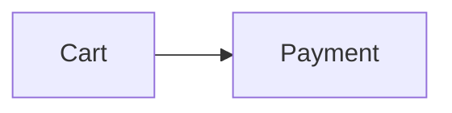

# Figures, glossary, quotes and footnotes

Part of the syntax reference (`../syntax.md` lists the topics).

## Figures and numbered references

````markdown
The flow is in :ref[fig-checkout]; limits are in :ref[tbl-limits].

:::figure{#fig-checkout} Checkout flow

:::

:::figure{#tbl-limits kind=table} Rate limits per plan
| Plan | Requests per minute |
| ---- | ------------------- |
| Free | 60                  |
:::
````

- `:::figure` wraps one image, diagram, table or code block. The title after the name (or `title="…"`) is the caption.
- Figures are numbered in document order, one counter per `kind`: `figure` (default) → Figure 1, `table` → Table 1, `listing` (code) → Listing 1.
- `:ref[id]` renders "Figure 2" as a link to the figure with `{#id}`; it may come before the figure. Give every figure you refer to an `{#id}` (e.g. `fig-…`, `tbl-…`, `lst-…`). An unknown id is a `figure/unknown-ref` warning; two figures with one id are `figure/duplicate-id`.
- Write `:ref[id]` instead of "the figure below": the numbers stay right when figures move.

## Glossary and abbreviations

```markdown
Every API call counts against the SLO.

:::glossary Glossary
- **API**: Application Programming Interface
- **SLO**: Service level objective: the target share of good requests
- **Error budget**: How much unreliability the SLO allows in a period
:::
```

- Every item of the list is `**Term**: definition` (or `**Term:** definition`); one item in another form turns the whole list back into a plain list (`glossary/entry`).
- The first use of each term in every section shows its definition on hover and links to it. Write the terms in the text exactly as defined: abbreviations (`API`) only match as written; other terms may change the case of their first letter. Plurals and compounds (`APIs`, `API-first`) don't match.
- Headings, code, links and URLs are never marked. Define each term once (`glossary/duplicate`), and don't give a heading or element the id `term-{slug}` of a term (`glossary/duplicate-id`; `## Term limits` clashes with the term *Limits*); a term no text uses is reported as `glossary/unused` (info).
- One glossary near the end of the document is usual; put terms an agent must know in it rather than expanding them in every paragraph.

## Quotes with attribution

```markdown
:::quote{author="Ada Lovelace" source="Notes" cite="https://example.com/notes"}
The quoted text.
:::
```

- Renders the body as a blockquote with a "— Author, *Source*" line; the source links to `cite`. Attributes: `author` (always give it: `quote/author`), `source`, `cite`.
- `cite` must be an `http(s)` or relative URL; anything else is dropped (`quote/cite`). An empty quote is `quote/empty`.
- A quote is not a numbered figure; use `:::figure` only for things you want numbered.

## Footnotes (GFM, since 1.6)

```markdown
Retries are capped at five[^retries].

[^retries]: Five covers 99.9% of transient failures.
    Indent further lines and paragraphs by 4 spaces.
```

- Labels are numbers or words without spaces, matched case-insensitively. Numbering follows the first reference, and the footnotes render as a numbered section at the end with back links, as on GitHub.
- Put definitions at the end of the section that uses them, or of the document. An unreferenced definition is not shown (`footnote/unused`), a reference without a definition stays plain text (`footnote/undefined`), and a repeated label keeps its first definition (`footnote/duplicate`).
- Write definitions as sentences: renderers without footnotes show them as written, but read a one-word definition (`[^1]: Note`) as a link target.
- Agents see footnotes as written; `smd agent --section` adds the definitions a section's references need.
